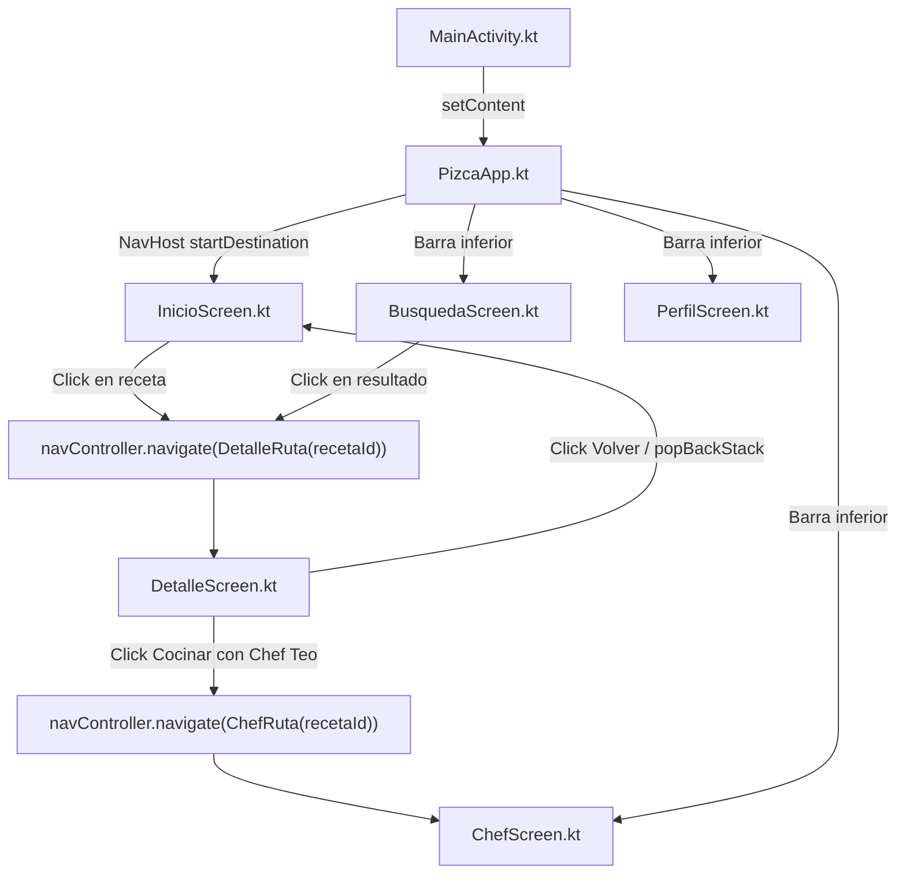

## 🧭 Navegación (Type-Safe)

La app usa la navegación oficial de Jetpack Compose con rutas `@Serializable`. Todo vive en `presentation/navigation/`:

- **Destinations.kt**: todas las rutas agrupadas en `sealed interface Destination`.
- **AppNavigation.kt**: la barra inferior y el `NavHost`.

- **NavController**: el "GPS" de la app. Guarda la pila de pantallas y hace los cambios.
- **NavHost**: el mapa que une cada ruta con su pantalla.
- **composable<Destination.X>**: registra una pantalla en el mapa.
- **toRoute()**: recupera los datos que viajan en la ruta (por ejemplo, el `recetaId`).

### Rutas

| Ruta | Tipo | Datos que lleva | Pantalla |
|---|---|---|---|
| `Destination.Inicio` | data object | — | InicioScreen |
| `Destination.Busqueda` | data object | — | BusquedaScreen |
| `Destination.Perfil` | data object | — | PerfilScreen |
| `Destination.Detalle` | data class | `recetaId: String` | DetalleScreen |
| `Destination.Chef` | data class | `recetaId: String?` (opcional) | ChefScreen |

### Flujo

- Las pantallas no reciben el `NavController`: reciben eventos como `onRecetaClick` y `onVolver`.
- La barra inferior usa `popUpTo`, `launchSingleTop` y `restoreState` para no repetir pantallas y recordar cada pestaña.
- En el Detalle se oculta la barra inferior.

📘 **Arquitectura completa, archivo por archivo:** [docs/tutorial_arquitectura.md](docs/tutorial_arquitectura.md)
