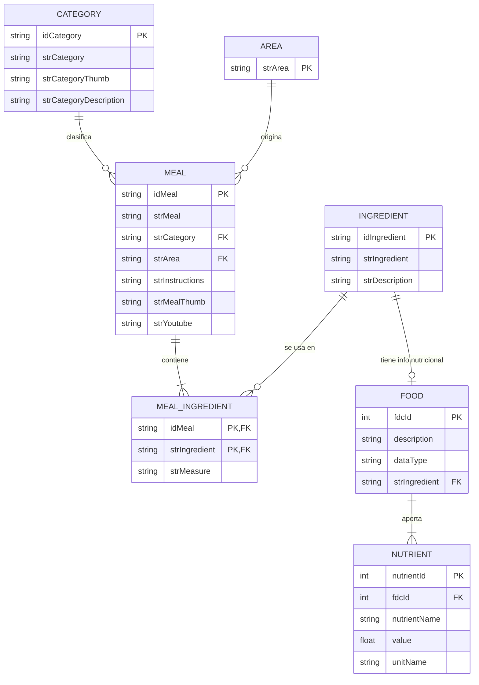
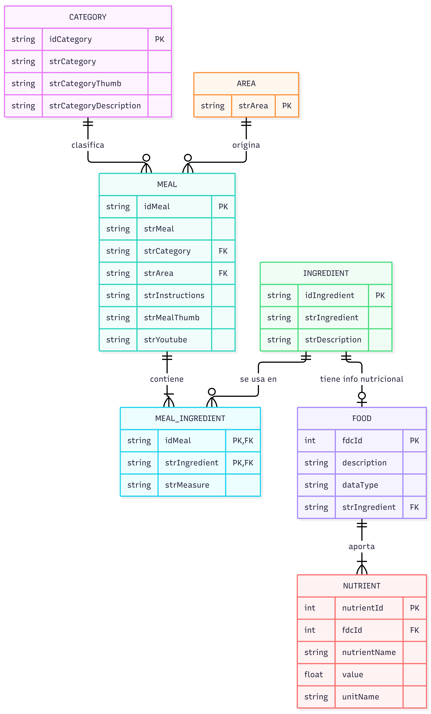
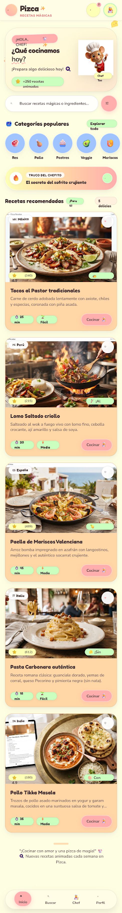
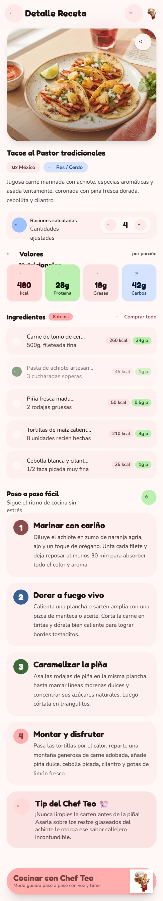
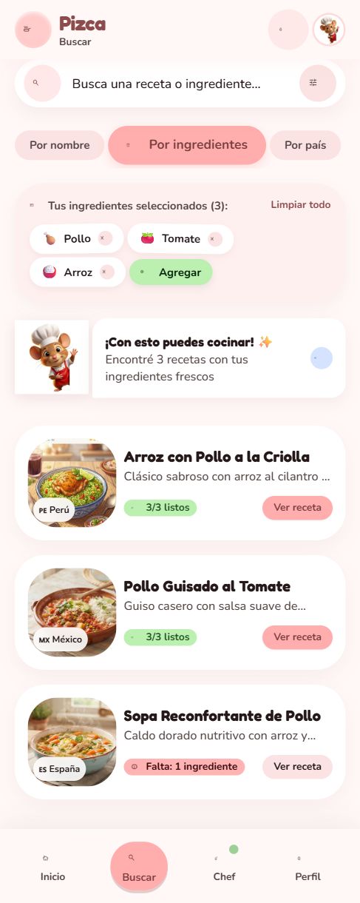
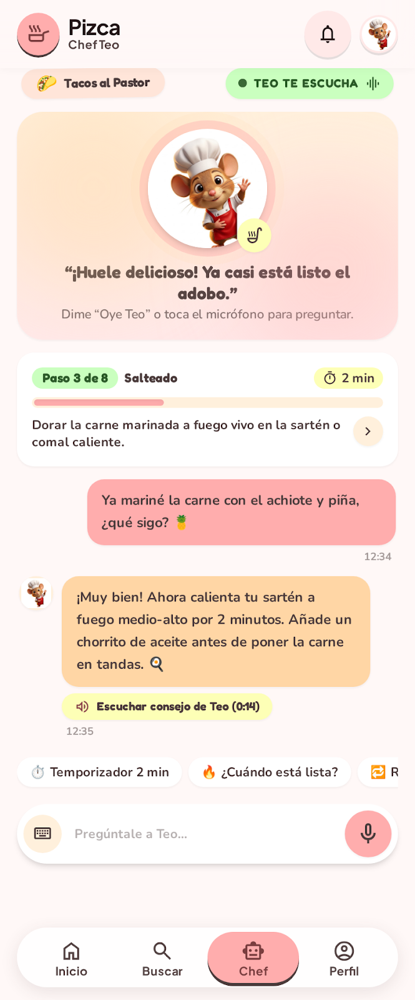
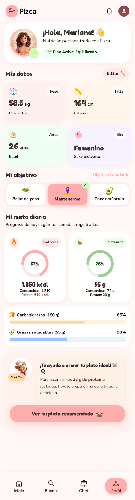
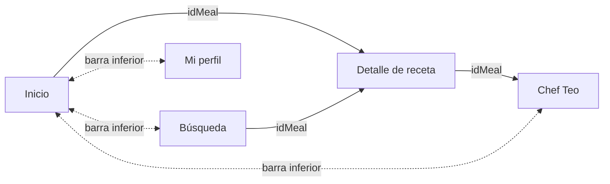
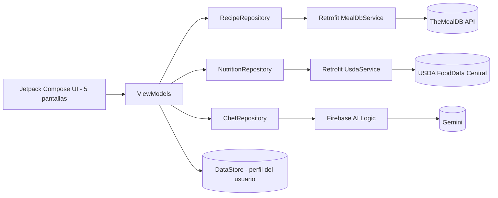
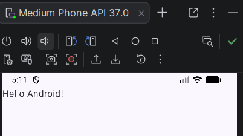

# 🐭 Pizca — Tu chef y nutricionista de bolsillo

> Proyecto de diseño y arquitectura de una aplicación móvil Android — SENA, ADSO.
> **Fase actual:** planificación sin código. El proyecto de Android Studio contiene solo el esqueleto autogenerado.

---

## 📑 Contenido

1. [Equipo](#-equipo)
2. [Elevator Pitch y APIs](#-hito-1-elevator-pitch-y-apis)
3. [Modelo de datos (ER)](#-hito-2-modelo-de-datos-er)
4. [Diseño de pantallas y navegación](#-hito-3-diseño-de-pantallas-y-navegación)
5. [Arquitectura y endpoints](#-hito-4-arquitectura-y-consumo-de-las-apis)
6. [Proyecto base](#-hito-5-proyecto-base-en-android-studio)
7. [Video de presentación](#-hito-6-video-de-presentación)
8. [Flujo de trabajo en GitHub](#-flujo-de-trabajo-github-flow)

---

## 👥 Equipo

| Integrante | Rol |
|---|---|
| Mariana Uribe Muñoz | Líder del repositorio, GitHub Flow y proyecto base |
| Valeria Usuga | Modelado de datos y arquitectura |
| Ismael Mira | Diseño UI/UX en Google Stitch |

---

## 🚀 Hito 1: Elevator Pitch y APIs

> Nuestra app se llama **Pizca** y consume dos APIs: **TheMealDB** para recetas y **USDA FoodData Central** para información nutricional. El problema que resolvemos es que muchas personas que cocinan en casa no saben qué preparar con lo que tienen, se pierden siguiendo una receta, o no saben cuánto deberían comer según sus objetivos. Pizca es un chef y nutricionista de bolsillo: busca recetas por nombre, país, categoría o ingredientes disponibles, guía la preparación paso a paso con **Chef Teo**, un asistente de IA (Gemini), y calcula las calorías y proteínas diarias según el peso y la meta del usuario, mostrando el aporte nutricional de cada ingrediente.

### ¿Por qué una app móvil?

El celular es lo que la persona tiene a mano en la cocina y en el supermercado, no un computador. Consultar una receta, avanzar paso a paso y preguntarle al chef mientras se cocina solo tiene sentido desde el teléfono.

### APIs y servicios

| Servicio | Uso | Autenticación |
|---|---|---|
| [TheMealDB](https://www.themealdb.com/) | Recetas, categorías, países e ingredientes | Clave pública de prueba (`1`) |
| [USDA FoodData Central](https://fdc.nal.usda.gov/) | Calorías y nutrientes de cada ingrediente | API key gratuita de api.data.gov |
| Gemini (Firebase AI Logic) | Conversación en tiempo real con Chef Teo | Configuración de Firebase |

### Recursos que usará la app

| API | Recurso | Descripción |
|---|---|---|
| TheMealDB | **Meal** | La receta: nombre, foto, instrucciones, ingredientes y medidas |
| TheMealDB | **Category** | Tipo de plato (res, pollo, postres, vegetariano…) |
| TheMealDB | **Area** | Cocina por país (mexicana, italiana, colombiana…) |
| TheMealDB | **Ingredient** | Ingrediente con su descripción |
| USDA | **Food** y **Nutrient** | Alimento y su aporte nutricional |

---

## 🗂️ Hito 2: Modelo de datos (ER)

### Relaciones

| Relación | Tipo | Explicación |
|---|---|---|
| Category → Meal | 1:N | Una categoría agrupa muchas recetas; cada receta pertenece a una sola categoría |
| Area → Meal | 1:N | Un país tiene muchas recetas; cada receta tiene un país de origen |
| Meal ↔ Ingredient | N:M | Una receta lleva muchos ingredientes y un ingrediente aparece en muchas recetas. Se resuelve con `MEAL_INGREDIENT`, que guarda la cantidad (`strMeasure`) |
| Ingredient → Food | 1:0..1 | Puente entre las dos APIs: un ingrediente de TheMealDB puede tener su ficha nutricional en USDA |
| Food → Nutrient | 1:N | Cada alimento aporta varios nutrientes (calorías, proteína, grasa, carbohidratos) |

> **Nota:** `Area` no tiene identificador numérico en TheMealDB, por eso su llave es el nombre (`strArea`).

---

## 🎨 Hito 3: Diseño de pantallas y navegación

🔗 **Prototipo en Google Stitch:** https://stitch.withgoogle.com/projects/13684901120045225553

**Estilo visual:** caricatura, paleta pastel (rosa coral `#FFADAD`, durazno `#FFD6A5`, crema `#FDFFB6`, menta `#CAFFBF`, azul cielo `#A0C4FF`), texto café oscuro `#4A3B3B`, tipografías **Fredoka** (títulos) y **Nunito** (textos). La mascota es **Chef Teo**, un ratoncito con gorro de chef y delantal rojo, diseño propio del equipo.

### Pantalla 1 — Inicio

- **Muestra:** saludo de Chef Teo, categorías populares y recetas recomendadas.
- **Datos:** `categories.php` para las categorías y `filter.php?c={categoria}` para las recetas.
- **Acciones:** tocar una categoría filtra las recetas; tocar una receta abre el **Detalle** enviando el `idMeal`.

### Pantalla 2 — Detalle de receta

- **Muestra:** foto del plato, país y categoría, valores nutricionales por porción, ingredientes con cantidades y pasos de preparación.
- **Datos:** `lookup.php?i={idMeal}` (TheMealDB) y `/foods/search?query={ingrediente}` (USDA) para el aporte nutricional de cada ingrediente.
- **Acciones:** ajustar el número de raciones (cálculo local), marcar como favorita y tocar **"Cocinar con Chef Teo"**, que abre el chat enviando el `idMeal`.

### Pantalla 3 — Búsqueda

- **Muestra:** buscador con tres modos (por nombre, por ingredientes, por país), los ingredientes seleccionados y los resultados.
- **Datos:** `search.php?s={nombre}`, `filter.php?i={ingrediente}`, `filter.php?a={pais}` y `list.php?a=list`.
- **Acciones:** agregar o quitar ingredientes, cambiar de modo y tocar un resultado para abrir el **Detalle** con su `idMeal`.

> **Nota:** en la versión gratuita de TheMealDB el filtro por ingrediente acepta uno a la vez. La búsqueda combinada (varios ingredientes) es una función premium; la app cruzará los resultados de cada ingrediente o usará la clave premium.

### Pantalla 4 — Chef Teo

- **Muestra:** Chef Teo con su estado ("Teo te escucha"), la receta en curso, el paso actual con barra de progreso y la conversación.
- **Datos:** los pasos salen de `strInstructions` (TheMealDB) y las respuestas las genera **Gemini** con el contexto de la receta.
- **Acciones:** escribir o hablar con el micrófono, usar respuestas rápidas (temporizador, "¿cuándo está lista?") y avanzar de paso.
- **A futuro:** animación del personaje con **Lottie** (esperando, escuchando, hablando).

### Pantalla 5 — Mi perfil nutricional

- **Muestra:** datos del usuario (peso, estatura, edad, sexo), objetivo y meta diaria de calorías y proteínas.
- **Datos:** cálculo local con fórmula de gasto energético; el perfil se guarda en **DataStore**. No consume API.
- **Acciones:** editar datos, elegir objetivo (bajar de peso, mantenerse, ganar músculo) y ver el plato recomendado.

### Flujo de navegación

La barra inferior conecta **Inicio, Buscar, Chef y Perfil**. El dato que viaja entre pantallas es el `idMeal` de la receta seleccionada.

---

## 🏗️ Hito 4: Arquitectura y consumo de las APIs

### Tabla de endpoints

**Base TheMealDB:** `https://www.themealdb.com/api/json/v1/1`
**Base USDA:** `https://api.nal.usda.gov/fdc/v1`

| Endpoint | Método | Parámetros | Propósito en la app |
|---|---|---|---|
| `/categories.php` | GET | — | Categorías en Inicio |
| `/filter.php?c={categoria}` | GET | `c` | Recetas de una categoría (Inicio) |
| `/lookup.php?i={idMeal}` | GET | `i` | Detalle de la receta |
| `/search.php?s={nombre}` | GET | `s` | Búsqueda por nombre |
| `/filter.php?i={ingrediente}` | GET | `i` | Búsqueda por ingrediente |
| `/filter.php?a={pais}` | GET | `a` | Búsqueda por país |
| `/list.php?a=list` | GET | `a=list` | Lista de países para el filtro |
| USDA `/foods/search` | GET | `query`, `api_key` | Calorías y proteínas de cada ingrediente (Detalle) |
| USDA `/food/{fdcId}` | GET | `fdcId`, `api_key` | Perfil nutricional completo |
| Gemini (SDK Firebase AI Logic) | — | mensaje + receta actual | Conversación con Chef Teo |

### Buenas prácticas planificadas

- **Patrón MVVM:** UI → ViewModel → Repositorio → Fuente remota (Retrofit / Firebase AI Logic).
- **Cliente HTTP:** Retrofit con Gson para serialización.
- **Asincronía:** Kotlin Coroutines (`suspend`, `Dispatchers.IO`).
- **Estados de UI:** Loading / Success / Error en cada pantalla.
- **Seguridad:** la API key de USDA se guarda en `local.properties` (excluido por `.gitignore`) y nunca se sube al repositorio. Gemini se protege con Firebase App Check.
- **Librerías previstas:** Coil (imágenes), DataStore (perfil del usuario), Navigation Compose, Lottie (animación de Chef Teo).

---

## 📱 Hito 5: Proyecto base en Android Studio

- **Plantilla:** Empty Activity (Jetpack Compose)
- **Lenguaje:** Kotlin · **Build:** Kotlin DSL (`build.gradle.kts`)
- **Package:** `com.adso.pizca` · **Min SDK:** 24
- **Sin código de aplicación:** solo el esqueleto autogenerado.

---

## 🎬 Hito 6: Video de presentación

🔗 **Video:** _pendiente — agregar enlace de YouTube o Google Drive_

| Integrante | Parte que presenta |
|---|---|
| Mariana Uribe Muñoz | Idea, APIs y proyecto base |
| Valeria Usuga | Diagrama ER y arquitectura MVVM |
| Ismael Mira | Diseño de pantallas en Google Stitch |

---

## 🔀 Flujo de trabajo (GitHub Flow)

1. Cada hito o cambio se trabaja en una **rama propia** a partir de `main` (por ejemplo, `docs/readme`, `docs/capturas`).
2. Se sube la rama y se abre un **Pull Request** hacia `main`.
3. Otro integrante **revisa y aprueba** el Pull Request.
4. Se hace **Merge** a `main`.
