# 🐭 Pizca — Tu chef y nutricionista de bolsillo

> Proyecto de diseño y arquitectura de una aplicación móvil Android — SENA, ADSO.
> **Fase actual:** Avance 4. Los usuarios califican recetas y ven las opiniones de todos con **Google Apps Script** y una **Google Sheet**. Chef Teo sigue conversando con **Gemini** y toda la app se ve en **español**.

---

## 📑 Contenido

1. [Equipo](#-equipo)
2. [Elevator Pitch y APIs](#-hito-1-elevator-pitch-y-apis)
3. [Modelo de datos (ER)](#-hito-2-modelo-de-datos-er)
4. [Diseño de pantallas y navegación](#-hito-3-diseño-de-pantallas-y-navegación)
5. [Arquitectura y endpoints](#-hito-4-arquitectura-y-consumo-de-las-apis)
6. [Proyecto base](#-hito-5-proyecto-base-en-android-studio)
7. [Video de presentación](#-hito-6-video-de-presentación)
8. [Navegación Type-Safe](#-navegación-type-safe)
9. [Avance 2: Capa de repositorio con TheMealDB y Room](#-avance-2-capa-de-repositorio-con-themealdb-y-room)
10. [Avance 3: Chef Teo con Gemini y app en español](#-avance-3-chef-teo-con-gemini-y-app-en-español)
11. [Avance 4: Calificaciones de la comunidad con Google Apps Script](#-avance-4-calificaciones-de-la-comunidad-con-google-apps-script)
12. [Flujo de trabajo en GitHub](#-flujo-de-trabajo-github-flow)

---

## 👥 Equipo

| Integrante | Rol |
|---|---|
| Mariana Uribe Muñoz | Líder del repositorio, GitHub Flow y proyecto base |
| Valeria Usuga | Modelado de datos y arquitectura |
| Ismael Mira | Diseño de pantallas en Claude Design |

---

## 🚀 Hito 1: Elevator Pitch y APIs

> Nuestra app se llama **Pizca** y consume dos APIs: **TheMealDB** para recetas y **USDA FoodData Central** para información nutricional. El problema que resolvemos es que muchas personas que cocinan en casa no saben qué preparar con lo que tienen, se pierden siguiendo una receta, o no saben cuánto deberían comer según sus objetivos. Pizca es un chef y nutricionista de bolsillo: busca recetas por nombre, país, categoría o ingredientes disponibles, guía la preparación paso a paso con **Chef Teo**, un asistente de IA (Gemini), y calcula las calorías y proteínas diarias según el peso y la meta del usuario, mostrando el aporte nutricional de cada ingrediente.

### ¿Por qué una app móvil?

El celular es lo que la persona tiene a mano en la cocina y en el supermercado, no un computador. Consultar una receta, avanzar paso a paso y preguntarle al chef mientras se cocina solo tiene sentido desde el teléfono.

### APIs y servicios

| Servicio | Uso | Autenticación |
|---|---|---|
| [TheMealDB](https://www.themealdb.com/) | Recetas, categorías, países e ingredientes | Clave pública de prueba (`1`) |
| [USDA FoodData Central](https://fdc.nal.usda.gov/) | Calorías y nutrientes de cada ingrediente | API key gratuita de api.data.gov |
| Gemini (Firebase AI Logic) | Conversación con Chef Teo y traducción de las recetas al español | Configuración de Firebase + App Check |

### Recursos que usará la app

| API | Recurso | Descripción |
|---|---|---|
| TheMealDB | **Meal** | La receta: nombre, foto, instrucciones, ingredientes y medidas |
| TheMealDB | **Category** | Tipo de plato (res, pollo, postres, vegetariano…) |
| TheMealDB | **Area** | Cocina por país (mexicana, italiana, colombiana…) |
| TheMealDB | **Ingredient** | Ingrediente con su descripción |
| USDA | **Food** y **Nutrient** | Alimento y su aporte nutricional |

---

## 🗂️ Hito 2: Modelo de datos (ER)

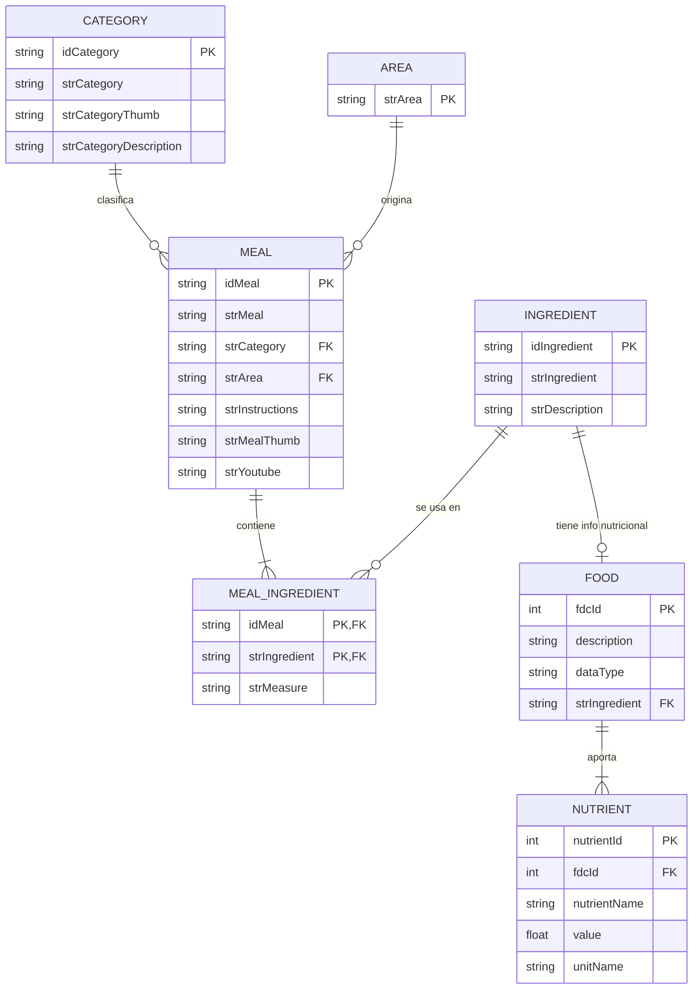

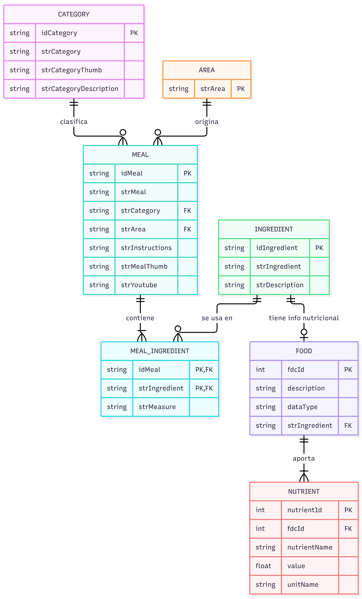

### Relaciones

| Relación | Tipo | Explicación |
|---|---|---|
| Category → Meal | 1:N | Una categoría agrupa muchas recetas; cada receta pertenece a una sola categoría |
| Area → Meal | 1:N | Un país tiene muchas recetas; cada receta tiene un país de origen |
| Meal ↔ Ingredient | N:M | Una receta lleva muchos ingredientes y un ingrediente aparece en muchas recetas. Se resuelve con `MEAL_INGREDIENT`, que guarda la cantidad (`strMeasure`) |
| Ingredient → Food | 1:0..1 | Puente entre las dos APIs: un ingrediente de TheMealDB puede tener su ficha nutricional en USDA |
| Food → Nutrient | 1:N | Cada alimento aporta varios nutrientes (calorías, proteína, grasa, carbohidratos) |

> **Nota:** `Area` no tiene identificador numérico en TheMealDB, por eso su llave es el nombre (`strArea`).

---

## 🎨 Hito 3: Diseño de pantallas y navegación

🔗**Diseño de pantallas:** hecho en Claude Design.
**Estilo visual:** caricatura, paleta pastel (rosa coral `#FFADAD`, durazno `#FFD6A5`, crema `#FDFFB6`, menta `#CAFFBF`, azul cielo `#A0C4FF`), texto café oscuro `#4A3B3B`, tipografías **Fredoka** (títulos) y **Nunito** (textos). La mascota es **Chef Teo**, un ratoncito con gorro de chef y delantal rojo, diseño propio del equipo.

### Pantalla 1 — Inicio

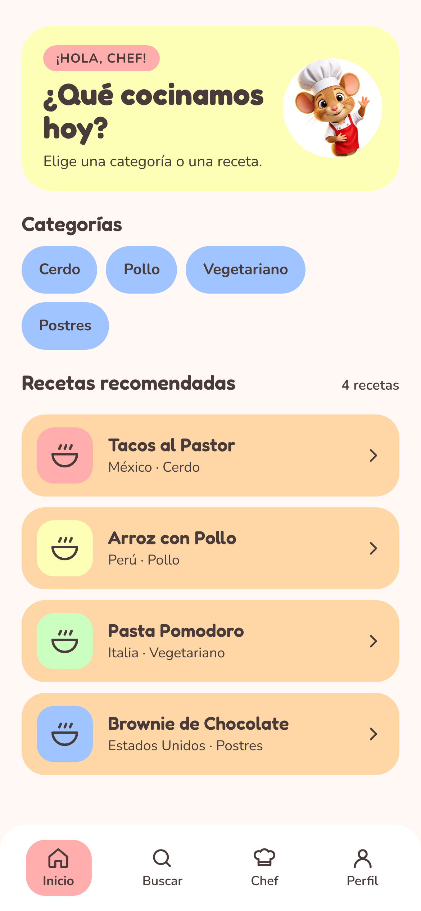

- **Muestra:** saludo de Chef Teo, categorías populares y recetas recomendadas.
- **Datos:** `categories.php` para las categorías y `filter.php?c={categoria}` para las recetas.
- **Acciones:** tocar una categoría filtra las recetas; tocar una receta abre el **Detalle** enviando el `idMeal`.

### Pantalla 2 — Detalle de receta

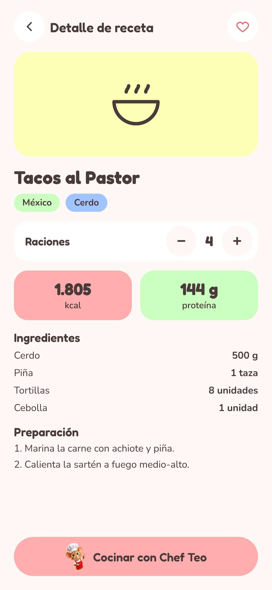

- **Muestra:** foto del plato, país y categoría, valores nutricionales por porción, ingredientes con cantidades y pasos de preparación.
- **Datos:** `lookup.php?i={idMeal}` (TheMealDB) y `/foods/search?query={ingrediente}` (USDA) para el aporte nutricional de cada ingrediente.
- **Acciones:** ajustar el número de raciones (cálculo local), marcar como favorita y tocar **"Cocinar con Chef Teo"**, que abre el chat enviando el `idMeal`.

### Pantalla 3 — Búsqueda

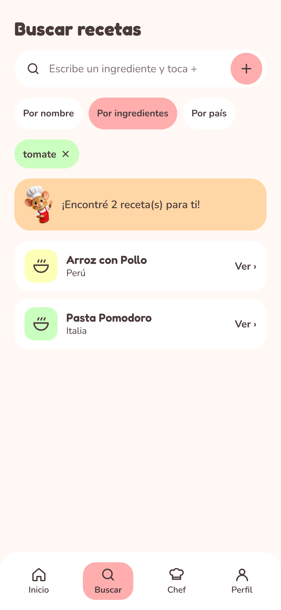

- **Muestra:** buscador con tres modos (por nombre, por ingredientes, por país), los ingredientes seleccionados y los resultados.
- **Datos:** `search.php?s={nombre}`, `filter.php?i={ingrediente}`, `filter.php?a={pais}` y `list.php?a=list`.
- **Acciones:** agregar o quitar ingredientes, cambiar de modo y tocar un resultado para abrir el **Detalle** con su `idMeal`.

> **Nota:** en la versión gratuita de TheMealDB el filtro por ingrediente acepta uno a la vez. La búsqueda combinada (varios ingredientes) es una función premium; por eso la app pide un ingrediente a la vez y se queda con las recetas que aparecen en todas las respuestas.

### Pantalla 4 — Chef Teo

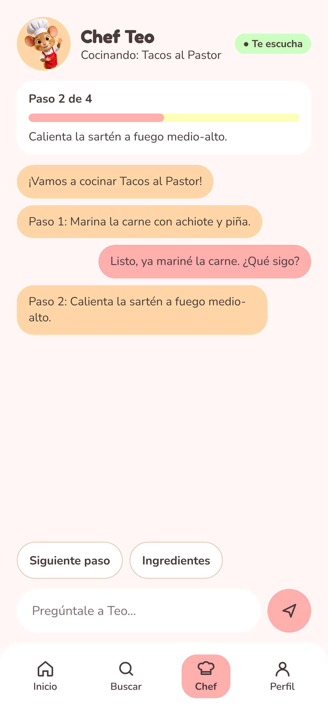

- **Muestra:** Chef Teo con su estado ("Te escucha" / "Escribiendo…"), la receta en curso, el paso actual con barra de progreso y la conversación.
- **Datos:** los pasos salen de `strInstructions` (TheMealDB), **Gemini** los traduce al español y genera las respuestas con el contexto de la receta.
- **Acciones:** escribir o hablar con el micrófono, usar respuestas rápidas (temporizador, "¿cuándo está lista?") y avanzar de paso.
- **A futuro:** animación del personaje con **Lottie** (esperando, escuchando, hablando).

### Pantalla 5 — Mi perfil nutricional

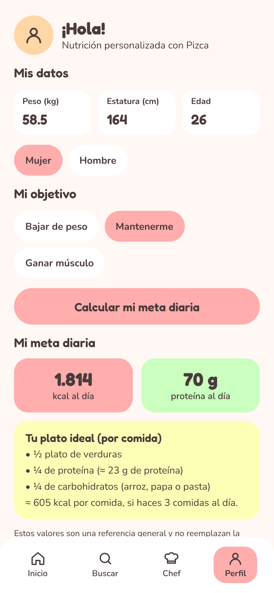

- **Muestra:** datos del usuario (peso, estatura, edad, sexo), objetivo y meta diaria de calorías y proteínas.
- **Datos:** cálculo local con fórmula de gasto energético; el perfil se guarda en el celular con **Room**. No consume API.
- **Acciones:** editar datos, elegir objetivo (bajar de peso, mantenerse, ganar músculo) y ver el plato recomendado.

La barra inferior conecta **Inicio, Buscar, Chef y Perfil**. El dato que viaja entre pantallas es el `idMeal` de la receta seleccionada.

---

## 🏗️ Hito 4: Arquitectura y consumo de las APIs

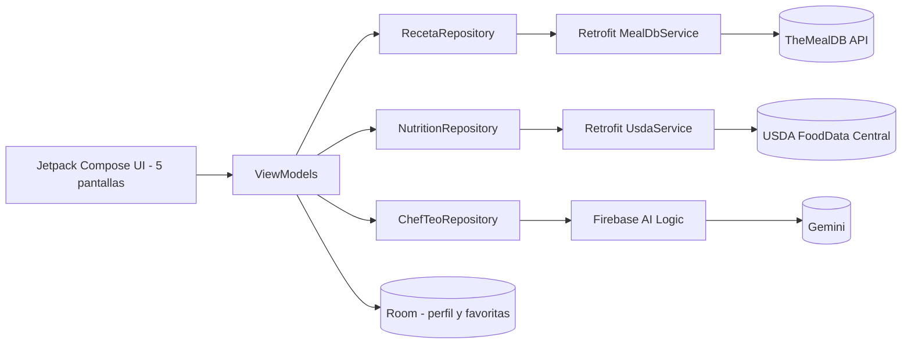

### Tabla de endpoints

**Base TheMealDB:** `https://www.themealdb.com/api/json/v1/1`
**Base USDA:** `https://api.nal.usda.gov/fdc/v1`

| Endpoint | Método | Parámetros | Propósito en la app |
|---|---|---|---|
| `/categories.php` | GET | — | Categorías en Inicio |
| `/filter.php?c={categoria}` | GET | `c` | Recetas de una categoría (Inicio) |
| `/lookup.php?i={idMeal}` | GET | `i` | Detalle de la receta |
| `/search.php?s={nombre}` | GET | `s` | Búsqueda por nombre |
| `/filter.php?i={ingrediente}` | GET | `i` | Búsqueda por ingrediente |
| `/filter.php?a={pais}` | GET | `a` | Búsqueda por país |
| `/list.php?a=list` | GET | `a=list` | Lista de países para el filtro |
| USDA `/foods/search` | GET | `query`, `api_key` | Calorías y proteínas de cada ingrediente (Detalle) |
| USDA `/food/{fdcId}` | GET | `fdcId`, `api_key` | Perfil nutricional completo |
| Gemini (SDK Firebase AI Logic) | — | mensaje + receta actual | Conversación con Chef Teo y traducción al español |

### Buenas prácticas planificadas

- **Patrón MVVM:** UI → ViewModel → Repositorio → Fuente remota (Retrofit / Firebase AI Logic).
- **Cliente HTTP:** Retrofit con Kotlinx Serialization para convertir el JSON y OkHttp Logging para ver las peticiones en Logcat.
- **Asincronía:** Kotlin Coroutines (`suspend`, `Dispatchers.IO`).
- **Estados de UI:** Loading / Success / Error en cada pantalla.
- **Seguridad:** la API key de USDA se guarda en `local.properties` (excluido por `.gitignore`) y nunca se sube al repositorio. Gemini se protege con Firebase App Check.
- **Librerías:** Retrofit, OkHttp, Kotlinx Serialization, Room (perfil y favoritas) y Navigation Compose. Previstas para más adelante: Coil (imágenes) y Lottie (animación de Chef Teo).

---

## 📱 Hito 5: Proyecto base en Android Studio

- **Plantilla:** Empty Activity (Jetpack Compose)
- **Lenguaje:** Kotlin · **Build:** Kotlin DSL (`build.gradle.kts`)
- **Package:** `com.adso.pizca` · **Min SDK:** 24
- **Sin código de aplicación:** solo el esqueleto autogenerado.

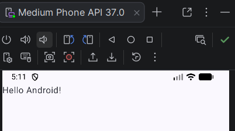

---

## 🎬 Hito 6: Video de presentación

🔗 **Video:** [Ver video de presentación](https://drive.google.com/file/d/1hSqCkEyFbiReyu0WETBN95fRdOllDmlM/view?usp=sharing)

| Integrante | Parte que presenta                   |
|---|--------------------------------------|
| Mariana Uribe Muñoz | Idea, APIs y proyecto base           |
| Valeria Usuga | Diagrama ER y arquitectura MVVM      |
| Ismael Mira | Diseño de pantallas en Claude Design |

---

## 🧭 Navegación (Type-Safe)

La app usa la navegación oficial de Jetpack Compose con rutas `@Serializable`. Todo vive en `presentation/navigation/`:

- **Destinations.kt**: todas las rutas agrupadas en `sealed interface Destination`.
- **AppNavigation.kt**: la barra inferior y el `NavHost`.

- **NavController**: el "GPS" de la app. Guarda la pila de pantallas y hace los cambios.
- **NavHost**: el mapa que une cada ruta con su pantalla.
- **composable<Destination.X>**: registra una pantalla en el mapa.
- **toRoute()**: recupera los datos que viajan en la ruta (por ejemplo, el `recetaId`).

### Rutas

| Ruta | Tipo | Datos que lleva | Pantalla |
|---|---|---|---|
| `Destination.Inicio` | data object | — | InicioScreen |
| `Destination.Busqueda` | data object | — | BusquedaScreen |
| `Destination.Perfil` | data object | — | PerfilScreen |
| `Destination.Detalle` | data class | `recetaId: String` | DetalleScreen |
| `Destination.Chef` | data class | `recetaId: String?` (opcional) | ChefScreen |

### Flujo

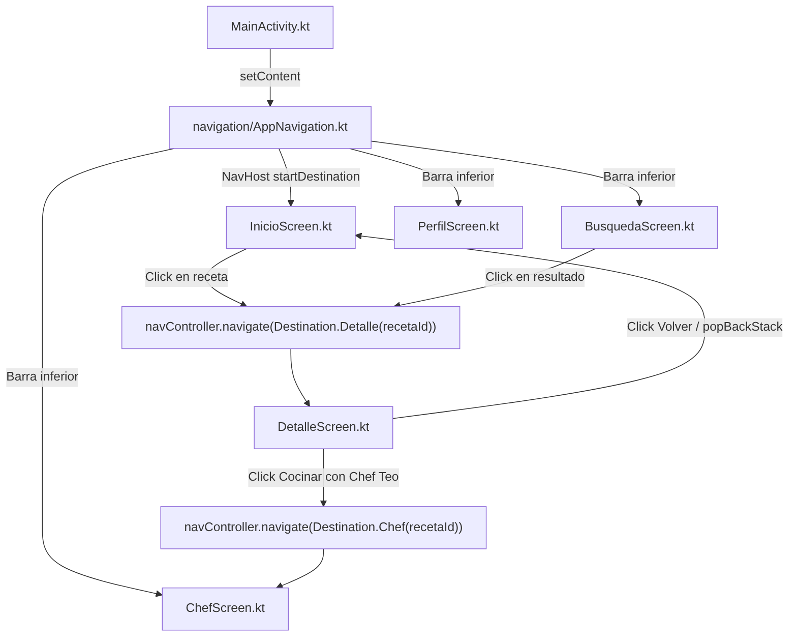

- Las pantallas no reciben el `NavController`: reciben eventos como `onRecetaClick` y `onVolver`.
- La barra inferior usa `popUpTo`, `launchSingleTop` y `restoreState` para no repetir pantallas y recordar cada pestaña.
- En el Detalle se oculta la barra inferior.

📘 **Arquitectura completa, archivo por archivo:** [docs/tutorial_arquitectura.md](docs/tutorial_arquitectura.md)

---

## 📦 Avance 2: Capa de repositorio con TheMealDB y Room

En este avance Pizca dejó las recetas escritas a mano: ahora trae recetas reales de **TheMealDB** con **Retrofit** y guarda las **favoritas** y el **perfil** en el celular con **Room**. Todo pasa por la **capa de repositorio**, con la misma arquitectura del Proyecto Integrador (*Referencia Avance 2*).

### Arquitectura

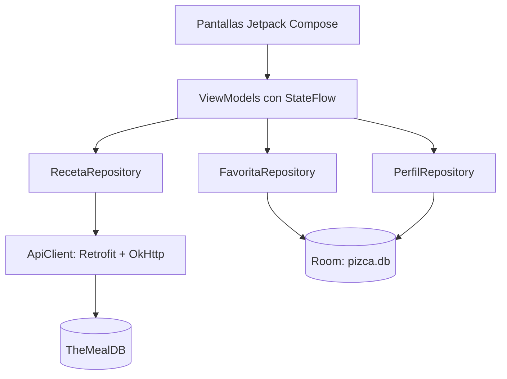

La pantalla le pide datos al ViewModel, el ViewModel al repositorio, y el repositorio decide si va a internet (TheMealDB) o a la base de datos del celular (Room). La pantalla nunca sabe de dónde vienen los datos.

### Qué hace cada capa

| Capa | Archivos | Qué hace |
|---|---|---|
| DTO | `data/dto/MealDbDtos.kt` | Molde exacto del JSON de TheMealDB, con `@Serializable` |
| Red | `data/api/TheMealDbApi.kt`, `data/network/ApiClient.kt` | Endpoints con Retrofit (`@GET` + `@Query`), Kotlinx Serialization y OkHttp Logging |
| Mapper | `data/mapper/MealMapper.kt` | Convierte la receta de TheMealDB (20 campos sueltos de ingredientes) en nuestra `Receta` |
| Repositorio | `data/repository/` | 3 interfaces + 3 implementaciones; funciones `suspend` que devuelven `Result<T>` con `runCatching` |
| Local | `data/local/`, `PizcaApp.kt` | Room: entidades, DAOs y la base `pizca.db`, que se crea al abrir la app |
| ViewModels | `presentation/viewmodel/` | `viewModelScope.launch`, `onSuccess` / `onFailure`, `isLoading` y `errorMessage` |

### Room: guardar, consultar, actualizar y eliminar

TheMealDB es una API pública de solo lectura (`GET`). Las operaciones de escritura las hace **Room** en el celular:

| Operación | Dónde se ve en la app | Cómo se hace |
|---|---|---|
| Guardar | Tocar ❤️ en el Detalle | `FavoritaDao.insertar` |
| Consultar | Perfil → "Mis favoritas" y el corazón lleno | `observarTodas` / `observarSiExiste` con `Flow` |
| Actualizar | "Calcular mi meta diaria" en Perfil | `PerfilDao.guardar` con `@Upsert` |
| Eliminar | Tocar ❤️ otra vez | `FavoritaDao.eliminar` |

Los datos siguen ahí después de cerrar y volver a abrir la app.

### Capturas

<table>
  <tr>
    <td align="center">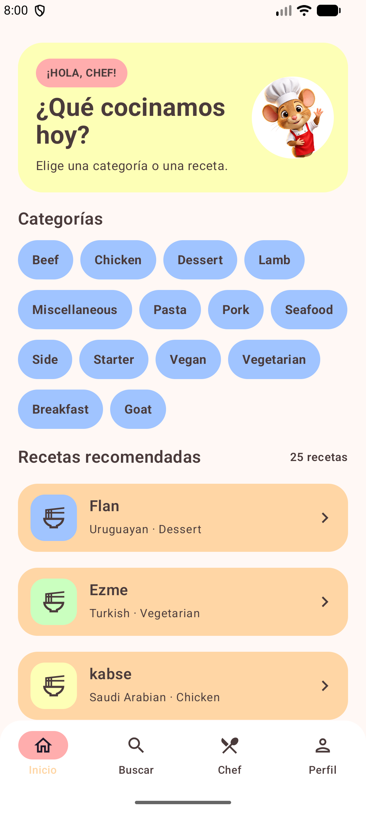 Inicio con recetas reales</td>
    <td align="center">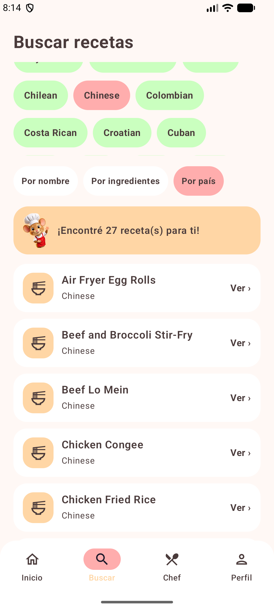 Búsqueda por país</td>
    <td align="center">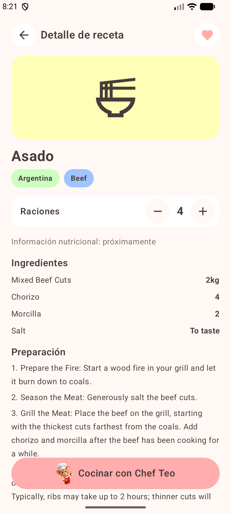 Detalle con favorita ❤️</td>
  </tr>
  <tr>
    <td align="center">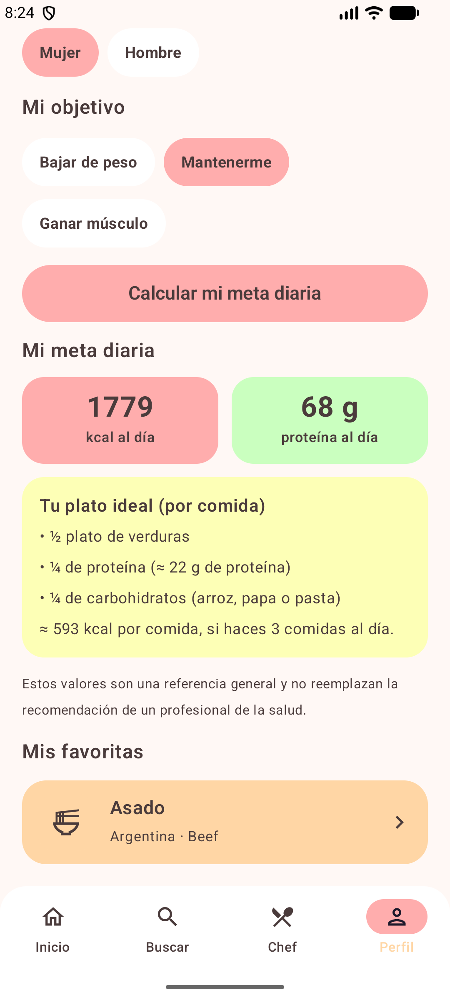 Favoritas guardadas en Room</td>
    <td align="center">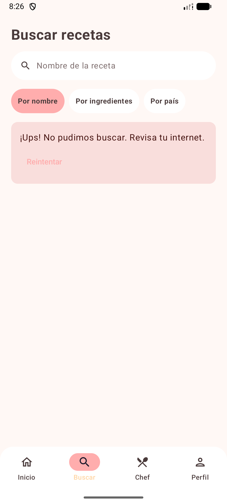 Sin internet: error y Reintentar</td>
    <td></td>
  </tr>
</table>

### Pruebas

- **`RecetaRepositoryTest`** (`app/src/test`): 4 pruebas contra TheMealDB real (búsqueda por nombre, receta por id, búsqueda sin resultados y varios ingredientes). Resultado: ✅ 4/4.
- **Sin internet:** cada pantalla muestra una tarjeta de error con **Reintentar** y la app no se cierra.

### Librerías nuevas

| Librería | Versión | Para qué |
|---|---|---|
| Retrofit + converter Kotlinx Serialization | 2.11.0 | Llamar a TheMealDB y convertir el JSON |
| OkHttp Logging Interceptor | 4.12.0 | Ver cada petición y respuesta en Logcat |
| Room (runtime, ktx, compiler) | 2.8.5 | Base de datos local |
| KSP | 2.3.10 | Genera el código de Room a partir de las anotaciones |

### Quién hizo qué

| Integrante | Parte del Avance 2 |
|---|---|
| Mariana Uribe Muñoz | Configuración (Gradle, permiso INTERNET, contratos), Room y pantalla de Perfil |
| Valeria Usuga | Capa de red, `RecetaRepositoryImpl` y pruebas unitarias |
| Ismael Mira | ViewModels, estados de carga y error, y conexión de las pantallas con los repositorios |

📘 **Explicación paso a paso de la capa de datos:** [docs/tutorial_capa_datos.md](docs/tutorial_capa_datos.md)

---

## 🤖 Avance 3: Chef Teo con Gemini y app en español

En este avance Chef Teo dejó de responder solo por palabras clave: ahora conversa con **Gemini** a través de **Firebase AI Logic**. Además, como TheMealDB solo trae datos en inglés, Gemini traduce las recetas y **toda la app se ve en español**. Cada traducción se guarda en el celular con **Room**, así que la segunda vez sale al instante.

### Arquitectura

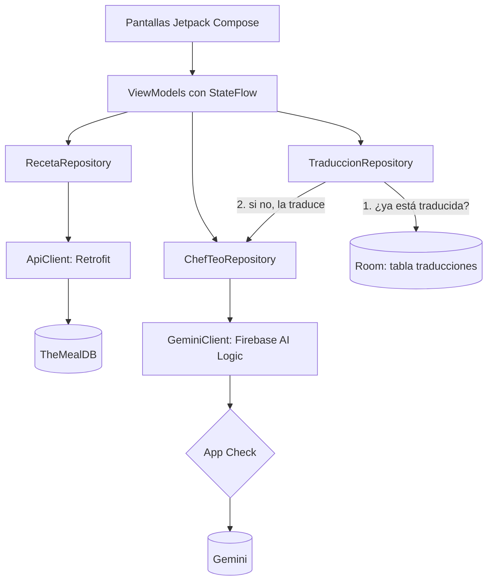

Es la misma arquitectura por capas del Avance 2: los ViewModels no saben que existe Gemini, solo conocen las interfaces `ChefTeoRepository` y `TraduccionRepository`.

### Qué hace cada pieza

| Pieza | Archivo | Qué hace |
|---|---|---|
| Cliente de Gemini | `data/network/GeminiClient.kt` | Crea los modelos de Gemini: `chat` (conversar, con la personalidad de Teo), `traductor` (receta completa en JSON) y `ligero` (traducciones cortas) |
| Repositorio de Chef Teo | `data/repository/ChefTeoRepository(Impl).kt` | `traducir()` una receta, `responder()` y `responderEnVivo()`, que entrega la respuesta por pedacitos |
| Repositorio de traducciones | `data/repository/TraduccionRepository(Impl).kt` | Busca primero en Room; si no está, le pregunta a Gemini y lo guarda. Traduce recetas, nombres de recetas y lo que el usuario busca (de español a inglés) |
| Diccionario | `data/mapper/Diccionario.kt` | Categorías y países en español con una tabla fija: no necesitan Gemini |
| Caché local | `data/local/TraduccionEntity.kt`, `TraduccionDao.kt` | Tabla `traducciones` (clave → valor). Se agregó con una **migración** de la versión 1 a la 2, sin borrar favoritas ni perfil |
| DTOs | `data/dto/TraduccionDto.kt` | Molde del JSON que responde Gemini |

### Qué cambió en cada pantalla

| Pantalla | Antes | Ahora |
|---|---|---|
| Inicio | Nombres y categorías en inglés | Categorías con el Diccionario y nombres traducidos por Gemini |
| Búsqueda | Había que escribir en inglés (*chicken*) | Se escribe en español (*pollo*): Gemini lo pasa a inglés para buscar en TheMealDB |
| Detalle | Ingredientes y pasos en inglés | Todo en español |
| Chef Teo | Solo entendía "siguiente", "ingredientes" y "paso" | Responde cualquier pregunta de cocina sabiendo la receta y el paso; la respuesta aparece palabra por palabra |

### Seguridad: sin API key en el código

La app **no guarda ninguna API key de Gemini**. Llama a Gemini a través de **Firebase AI Logic**, y **Firebase App Check** comprueba que la petición viene de nuestra app. El archivo `google-services.json` sí está en el repositorio: solo identifica el proyecto de Firebase, no es una contraseña.

Para correr el proyecto en un emulador nuevo hay que registrar su **token de depuración**:

1. Correr la app y buscar `secret` en **Logcat**.
2. Copiar el código que aparece después de *"Enter this debug secret into the allow list…"*.
3. Registrarlo en Firebase: **App Check → Apps → ⋮ → Administrar tokens de depuración**.

### Cómo se hizo más rápido

| Truco | Dónde |
|---|---|
| Gemini "piensa" menos antes de responder (`ThinkingLevel.LOW`) | `GeminiClient` |
| La respuesta llega por pedacitos (`generateContentStream`) y se va mostrando | `ChefTeoRepositoryImpl`, `ChefViewModel` |
| Al conversar solo se envía el paso actual, no la receta completa | `ChefTeoRepositoryImpl` |
| Las traducciones se guardan en Room y no se vuelven a pedir | `TraduccionRepositoryImpl` |
| Los nombres de una lista se traducen en **una sola** llamada | `TraduccionRepositoryImpl` |

### Si Gemini falla

La app no se cae: Teo avisa que no pudo traducir y sigue con la receta en inglés, las listas se quedan con los nombres originales y la búsqueda usa lo que se escribió. El motivo del error queda en **Logcat** con las etiquetas `ChefTeo` y `Traduccion`.

### Capturas

<table>
  <tr>
    <td align="center">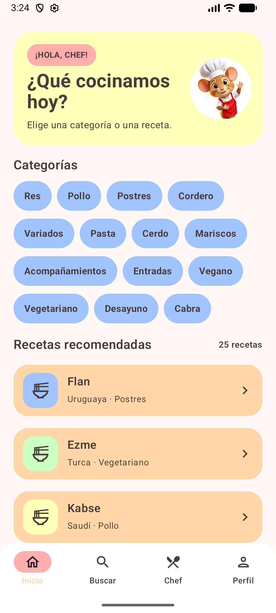 Inicio en español</td>
    <td align="center">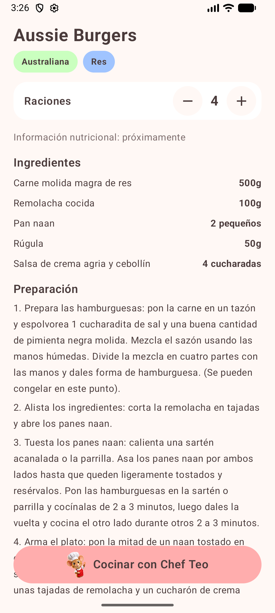 Detalle traducido</td>
    <td align="center">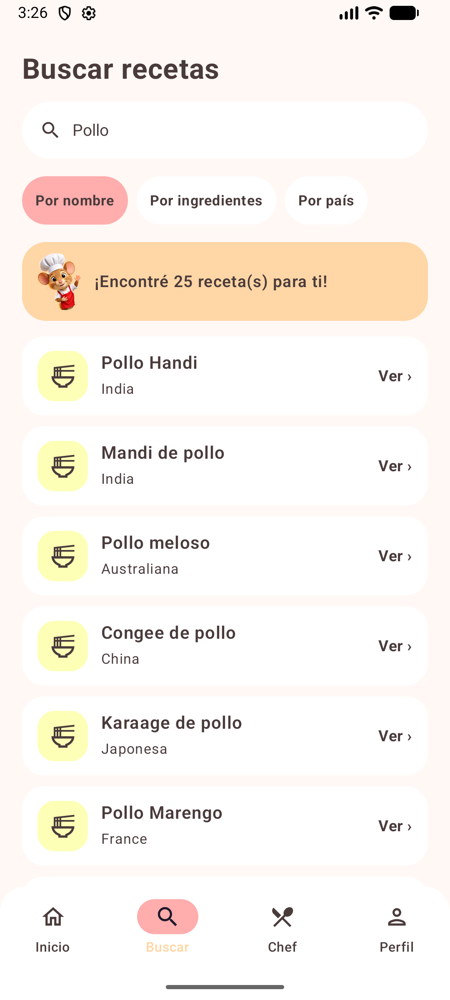 Búsqueda: "pollo"</td>
  </tr>
  <tr>
    <td align="center">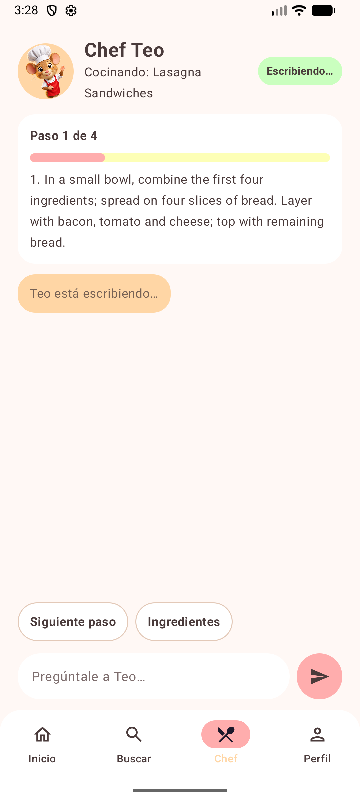 "Teo está escribiendo…"</td>
    <td align="center">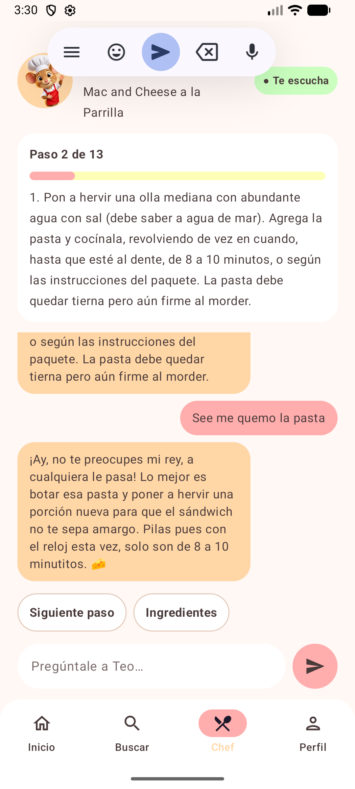 Teo responde con Gemini</td>
    <td align="center">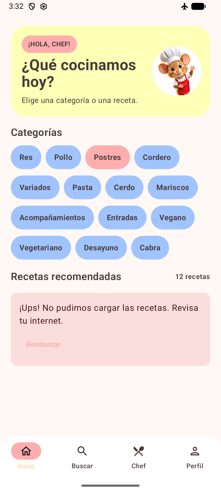 Sin internet: la app no se cae</td>
  </tr>
</table>

### Pruebas

| Prueba | Resultado esperado | Estado |
|---|---|---|
| Abrir Chef Teo con una receta | El paso 1 sale en español | ✅ |
| "Siguiente paso" | Avanza al instante, sin llamar a Gemini | ✅ |
| Pregunta libre ("¿Con qué reemplazo la mantequilla?") | Respuesta coherente con la receta | ✅ |
| Modo avión | Teo avisa y la app no se cierra | ✅ |
| Inicio, Detalle y Búsqueda | Nombres, categorías, países, ingredientes y pasos en español | ✅ |
| Buscar "pollo" | Aparecen recetas de pollo | ✅ |

### Librerías nuevas

| Librería | Versión | Para qué |
|---|---|---|
| Firebase BoM | 35.1.0 | Elige las versiones correctas de las librerías de Firebase |
| `firebase-ai` | (BoM) | Firebase AI Logic: llamar a Gemini desde la app |
| `firebase-appcheck-debug` | (BoM) | App Check en modo depuración (emulador) |
| Plugin `com.google.gms.google-services` | 4.5.0 | Lee el `google-services.json` |

### Quién hizo qué

| Integrante | Parte del Avance 3 |
|---|---|
| Mariana Uribe Muñoz | Coordinación, revisión de los Pull Requests y pruebas |
| Valeria Usuga | Proyecto en Firebase, App Check, `GeminiClient` y `ChefTeoRepository` |
| Ismael Mira | Indicador "Teo está escribiendo…" y conexión de `ChefViewModel` con Gemini |

📘 **Explicación paso a paso de la integración con Gemini:** [docs/tutorial_gemini.md](docs/tutorial_gemini.md)

---

## ⭐ Avance 4: Calificaciones de la comunidad con Google Apps Script

En este avance los usuarios pueden **calificar una receta** (1 a 5 estrellas y un comentario) y ver el **promedio y los comentarios de todos**. Room guarda lo personal de cada usuario; para lo que se comparte entre usuarios integramos **Google Apps Script** como un backend ligero que guarda los datos en una **Google Sheet**.

### Arquitectura

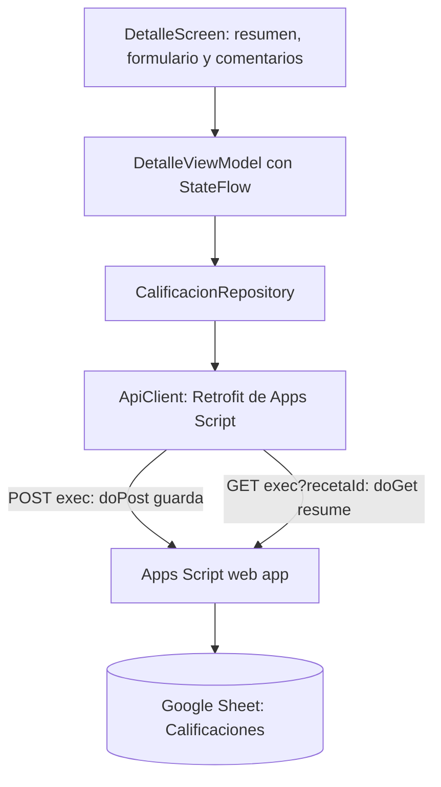

Es la misma arquitectura por capas de los avances anteriores: `DetalleViewModel` solo conoce la interfaz `CalificacionRepository` y no sabe que detrás hay un Apps Script.

### Qué hace cada pieza

| Pieza | Archivo | Qué hace |
|---|---|---|
| Script | Apps Script `Pizca Calificaciones API` | `doPost` valida y guarda una fila; `doGet` devuelve el promedio, el total y los últimos 20 comentarios de una receta |
| Hoja de datos | Google Sheet `Pizca – Calificaciones` | Columnas `fecha`, `recetaId`, `estrellas` y `comentario` |
| DTOs | `data/dto/CalificacionDtos.kt` | Moldes del JSON que se envía y se recibe |
| Endpoints | `data/api/CalificacionesApi.kt` | `@GET("exec")` con `@Query("recetaId")` y `@POST("exec")` con `@Body` |
| Cliente | `data/network/ApiClient.kt` | Un segundo Retrofit con la URL del Apps Script; comparte el cliente OkHttp, así que todo se ve en Logcat |
| Repositorio | `data/repository/CalificacionRepository(Impl).kt` | `obtenerResumen()` y `enviar()`; devuelven `Result` y revisan el campo `ok` del script |
| Pantalla | `presentation/components/Calificaciones.kt`, `DetalleScreen.kt` | Resumen "⭐ promedio · opiniones" bajo el título, formulario al final y hoja con los comentarios |

### Endpoints del Apps Script

| Método | Ruta | Cuerpo / parámetros | Respuesta |
|---|---|---|---|
| GET | `/exec?recetaId={id}` | `recetaId` | `{ ok, recetaId, promedio, total, comentarios[] }` |
| POST | `/exec` | `{ recetaId, estrellas, comentario }` | `{ ok }` o `{ ok: false, error }` |

### Room vs. Apps Script

| | Room | Apps Script |
|---|---|---|
| Dónde guarda | En el celular | En la nube (Google Sheet) |
| Qué guarda | Lo personal: favoritas y perfil | Lo compartido: calificaciones de todos |
| ¿Necesita internet? | No | Sí |

### Si Apps Script falla

La receta se muestra igual: el resumen dice *"Calificaciones no disponibles"* y, si falla el envío, aparece *"No pudimos enviar tu opinión. Revisa tu conexión."* La app no se cierra.

### Capturas

<table>
  <tr>
    <td align="center">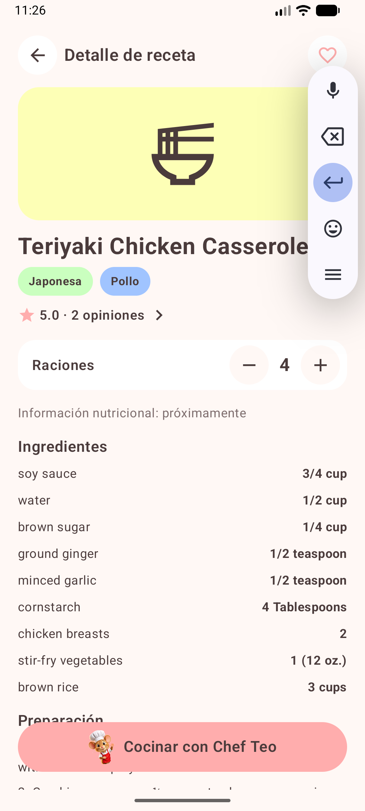 Resumen: ⭐ promedio · opiniones</td>
    <td align="center">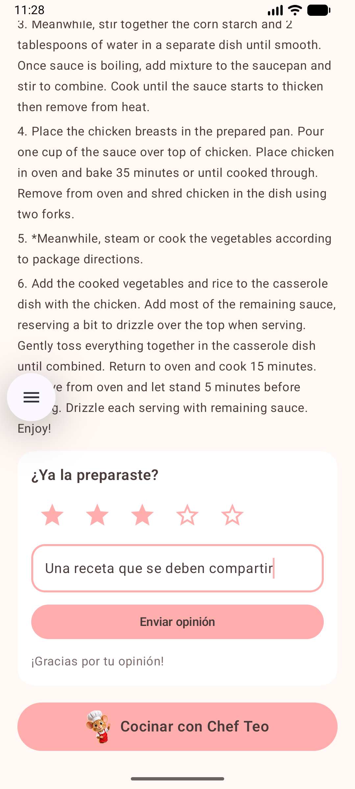 "¿Ya la preparaste?"</td>
  </tr>
  <tr>
    <td align="center" colspan="2">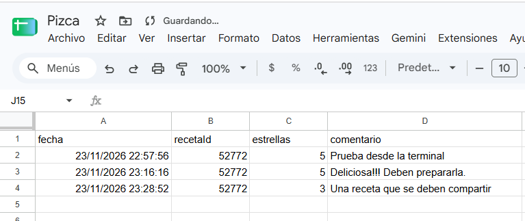 Las calificaciones en la Google Sheet</td>
  </tr>
</table>

### Pruebas

| Prueba | Resultado esperado | Estado |
|---|---|---|
| GET desde el navegador con `?recetaId=52772` | JSON con `ok: true`, promedio y total | ✅ |
| POST desde PowerShell (`Invoke-RestMethod`) | `ok: true` y una fila nueva en la Sheet | ✅ |
| Abrir el detalle de una receta calificada | Aparece "⭐ promedio · opiniones" | ✅ |
| Enviar una calificación desde la app | "¡Gracias por tu opinión!", fila nueva y resumen actualizado | ✅ |
| Tocar el resumen | Se abre la hoja con los comentarios | ✅ |

### Quién hizo qué

| Integrante | Parte del Avance 4 |
|---|---|
| Mariana Uribe Muñoz | Apps Script y Google Sheet |
| Valeria Usuga | Revisión del Pull Request |
| Ismael Mira | Pruebas |

---

## 🔀 Flujo de trabajo (GitHub Flow)

1. Cada hito o cambio se trabaja en una **rama propia** a partir de `develop` (por ejemplo, `feature/capa-red`, `docs/avance-2`).
2. Se sube la rama y se abre un **Pull Request** hacia `develop`.
3. Otro integrante **revisa y aprueba** el Pull Request.
4. Se hace **Merge** a `develop`. Cuando `develop` está estable, se pasa a `main` con otro Pull Request.
