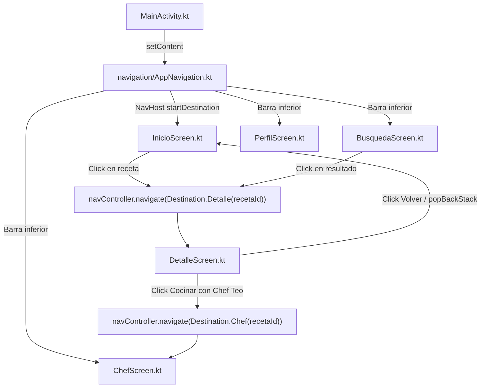

# Pizca — Arquitectura y flujo de ejecución

Este documento explica cómo está organizada la app **Pizca**, qué hace cada archivo y cómo viajan los datos desde que se abre la app hasta que el usuario cocina con Chef Teo.

> **Actualizado al Avance 2:** las recetas llegan de **TheMealDB** con **Retrofit** y las favoritas y el perfil se guardan con **Room**, siempre a través de la capa de repositorio. El detalle de esa capa está en [tutorial_capa_datos.md](tutorial_capa_datos.md).

## 1. Estructura del proyecto

```text
app/src/main/java/com/adso/pizca/
│
├── data/                                <-- CAPA DE DATOS
│    ├── api/
│    │    └── TheMealDbApi.kt            (endpoints de TheMealDB con Retrofit)
│    ├── network/
│    │    └── ApiClient.kt               (Retrofit + OkHttp Logging + Kotlinx Serialization)
│    ├── dto/                            (modelos de datos)
│    │    ├── MealDbDtos.kt              (el JSON de TheMealDB tal como llega)
│    │    ├── Receta.kt                  (Receta + Ingrediente, el modelo de la app)
│    │    ├── Mensaje.kt                 (mensajes del chat con Chef Teo)
│    │    └── PerfilUsuario.kt           (perfil, Objetivo y MetaDiaria)
│    ├── mapper/
│    │    └── MealMapper.kt              (convierte MealDto en Receta)
│    ├── local/                          (base de datos Room)
│    │    ├── RecetaFavoritaEntity.kt    (tabla recetas_favoritas)
│    │    ├── PerfilEntity.kt            (tabla perfil)
│    │    ├── FavoritaDao.kt             (consultas de favoritas)
│    │    ├── PerfilDao.kt               (consultas del perfil)
│    │    └── PizcaDatabase.kt           (la base pizca.db)
│    └── repository/                     (interfaces + implementaciones)
│         ├── RecetaRepository.kt        (contrato de recetas)
│         ├── RecetaRepositoryImpl.kt    (recetas desde TheMealDB)
│         ├── FavoritaRepository.kt      (contrato de favoritas)
│         ├── FavoritaRepositoryImpl.kt  (favoritas en Room)
│         ├── PerfilRepository.kt        (contrato del perfil)
│         └── PerfilRepositoryImpl.kt    (perfil en Room)
│
├── presentation/                        <-- CAPA DE PRESENTACIÓN
│    ├── viewmodel/                      (estado de cada pantalla con StateFlow)
│    │    ├── InicioViewModel.kt
│    │    ├── DetalleViewModel.kt
│    │    ├── BusquedaViewModel.kt
│    │    ├── ChefViewModel.kt
│    │    └── PerfilViewModel.kt
│    ├── navigation/                     (navegación type-safe con @Serializable)
│    │    ├── Destinations.kt
│    │    └── AppNavigation.kt
│    ├── screens/                        (pantallas Jetpack Compose)
│    │    ├── InicioScreen.kt
│    │    ├── DetalleScreen.kt
│    │    ├── BusquedaScreen.kt
│    │    ├── ChefScreen.kt
│    │    └── PerfilScreen.kt
│    └── components/                     (componentes de UI reutilizables)
│         ├── RecetaCard.kt
│         ├── StatCard.kt
│         ├── ChipPildora.kt
│         ├── IconoReceta.kt
│         ├── ChefTeoImagen.kt
│         └── EstadoCarga.kt             (Cargando y ErrorCard)
│
├── ui/theme/                            <-- TEMA (MATERIAL 3, PALETA PASTEL)
│    ├── Color.kt
│    ├── Theme.kt
│    └── Type.kt
│
├── PizcaApp.kt                          <-- ARRANQUE: crea la base de datos Room
└── MainActivity.kt                      <-- PUNTO DE ENTRADA DE LA INTERFAZ

app/src/test/java/com/adso/pizca/
└── RecetaRepositoryTest.kt              (pruebas de la capa de red contra TheMealDB)

docs/                                    <-- DOCUMENTACIÓN
├── tutorial_arquitectura.md             (este archivo)
├── tutorial_capa_datos.md               (red, repositorio y Room, paso a paso)
└── capturas/                            (imágenes del README)
```

## 2. Diagrama del flujo



## 3. Archivo por archivo

### 3.1 Capa de datos (`data/`)

| Archivo | Qué hace |
|---|---|
| `api/TheMealDbApi.kt` | Interface de Retrofit con los endpoints de TheMealDB (`search.php`, `lookup.php`, `categories.php`, `filter.php`, `list.php`). Todas las funciones son `suspend`. |
| `network/ApiClient.kt` | Crea Retrofit con la URL base, el convertidor de Kotlinx Serialization y el interceptor de OkHttp que muestra cada petición en Logcat. |
| `dto/MealDbDtos.kt` | El JSON de TheMealDB con `@Serializable`. `meals` es nullable porque, si no hay resultados, la API responde `null`. |
| `dto/Receta.kt` | El modelo que usa la app: id, nombre, categoría, país, foto, ingredientes y pasos. |
| `dto/Mensaje.kt` | Un mensaje del chat: texto y si lo escribió Chef Teo o el usuario. |
| `dto/PerfilUsuario.kt` | Datos del usuario (peso, estatura, edad, sexo), su `Objetivo` y la `MetaDiaria` calculada. |
| `mapper/MealMapper.kt` | Junta los 20 campos sueltos de ingredientes en una lista y parte las instrucciones en pasos. |
| `local/` | Room: las dos tablas (`recetas_favoritas` y `perfil`), sus DAOs y la base `pizca.db`. |
| `repository/` | Las 3 interfaces (el "menú") y sus 3 implementaciones (la "cocina"). Las funciones devuelven `Result<T>` usando `runCatching`, así un error de red no cierra la app. |

### 3.2 ViewModels (`presentation/viewmodel/`)

Cada ViewModel guarda el estado de su pantalla en un `MutableStateFlow` privado y lo expone como `StateFlow` de solo lectura. La pantalla lo lee con `collectAsState()` y se vuelve a dibujar sola cuando el valor cambia.

Desde el Avance 2, cada ViewModel recibe su repositorio por el **constructor** y lo llama dentro de `viewModelScope.launch`, manejando la respuesta con `onSuccess` / `onFailure`.

| ViewModel | Estado que maneja | Acciones | Repositorios |
|---|---|---|---|
| `InicioViewModel` | categorías, categoría seleccionada, recetas, `isLoading`, `errorMessage` | `cargarRecetas()`, `seleccionarCategoria()` | `RecetaRepository` |
| `DetalleViewModel` | receta, raciones, `esFavorita`, `isLoading`, `errorMessage` | `cargarReceta()`, `sumarRacion()`, `restarRacion()`, `cambiarFavorita()` | `RecetaRepository`, `FavoritaRepository` |
| `BusquedaViewModel` | modo, texto, ingredientes, países, país seleccionado, resultados, `isLoading`, `errorMessage` | `cambiarModo()`, `cambiarTexto()`, `agregarIngrediente()`, `quitarIngrediente()`, `seleccionarPais()`, `actualizarResultados()` | `RecetaRepository` |
| `ChefViewModel` | receta, paso actual, mensajes | `cargarReceta()`, `siguientePaso()`, `decirIngredientes()`, `enviarMensaje()` | `RecetaRepository` |
| `PerfilViewModel` | perfil, meta diaria, error, favoritas | `calcular()` (y guarda el perfil) | `PerfilRepository`, `FavoritaRepository` |

### 3.3 Componentes reutilizables (`presentation/components/`)

| Componente | Qué dibuja | Dónde se usa |
|---|---|---|
| `RecetaCard` | Tarjeta de receta con icono, nombre, país · categoría y flecha | Inicio y Perfil (Mis favoritas) |
| `StatCard` | Tarjeta de un dato con número grande (kcal, proteína, metas) | Detalle y Perfil |
| `ChipPildora` | Chip redondo que se pone rosado al seleccionarlo | Inicio, Búsqueda (países) y Perfil |
| `IconoReceta` | Cuadrito de color según la categoría de TheMealDB | RecetaCard y Búsqueda |
| `ChefTeoImagen` | La imagen de Chef Teo | Inicio, Detalle, Búsqueda y Chef |
| `Cargando` | Ruedita mientras llegan los datos | Inicio, Búsqueda y Detalle |
| `ErrorCard` | Tarjeta de error con botón **Reintentar** | Inicio, Búsqueda y Detalle |

### 3.4 Navegación (`presentation/navigation/`)

- **`Destinations.kt`**: todas las rutas dentro de `sealed interface Destination`. `Inicio`, `Busqueda` y `Perfil` son `data object` (no llevan datos). `Detalle(recetaId)` y `Chef(recetaId?)` son `data class` porque llevan el id de la receta.
- **`AppNavigation.kt`**: crea el `NavController`, la barra inferior de 4 pestañas y el `NavHost` que conecta cada `Destination` con su pantalla. Con `toRoute()` recupera el `recetaId` que viaja en la ruta. La barra se oculta en el Detalle.

Las pantallas no reciben el `NavController`: reciben eventos como `onRecetaClick`, `onVolver` y `onCocinar`. Así cada pantalla no depende de la navegación. Desde el Avance 2, Perfil también recibe `onRecetaClick` para abrir una favorita.

### 3.5 Punto de entrada (`PizcaApp.kt` y `MainActivity.kt`)

- **`PizcaApp.kt`**: se ejecuta una sola vez al arrancar la app, antes que cualquier pantalla, y crea la base de datos `pizca.db` con Room. Está registrada en el `AndroidManifest.xml` con `android:name=".PizcaApp"`.
- **`MainActivity.kt`**: activa `enableEdgeToEdge()`, aplica `PizcaTheme` y llama a `AppNavigation()`.

## 4. Caso práctico: de Inicio a cocinar con Chef Teo

1. **Apertura:** `PizcaApp` crea la base de datos y `MainActivity` carga `AppNavigation()`, que muestra `InicioScreen` (`startDestination = Destination.Inicio`).
2. **Cargar recetas:** `InicioViewModel` llama a `cargarRecetas()`. Mientras espera, `isLoading` es `true` y la pantalla muestra `Cargando`. El repositorio pide `categories.php` y `search.php?s=` con Retrofit, el mapper convierte cada `MealDto` en `Receta` y el `StateFlow` de recetas se actualiza.
3. **Filtrar:** el usuario toca la categoría "Chicken". `seleccionarCategoria("Chicken")` llama a `obtenerPorCategoria()`, que pide `filter.php?c=Chicken`.
4. **Ir al detalle:** el usuario toca una receta. `RecetaCard` llama a `onRecetaClick(id)` y `AppNavigation` ejecuta `navController.navigate(Destination.Detalle(id))`.
5. **Recibir el dato:** `AppNavigation` recupera el id con `entrada.toRoute<Destination.Detalle>()` y se lo pasa a `DetalleScreen`.
6. **Cargar la receta:** `DetalleViewModel.cargarReceta(id)` pide la receta completa con `lookup.php?i={id}` y, al mismo tiempo, escucha en Room si esa receta es favorita.
7. **Guardar favorita:** el usuario toca el ❤️. `cambiarFavorita()` llama a `FavoritaRepositoryImpl.alternarFavorita()`, que la guarda en la tabla `recetas_favoritas`. Room avisa del cambio, el corazón se pinta lleno y la receta aparece en Perfil → "Mis favoritas", incluso después de cerrar la app.
8. **Cocinar:** el botón "Cocinar con Chef Teo" ejecuta `navController.navigate(Destination.Chef(id))`. `ChefScreen` carga la receta y Chef Teo guía paso a paso con `siguientePaso()`.
9. **Sin internet:** si una petición falla, `runCatching` la convierte en `Result.failure`. El ViewModel llena `errorMessage` y la pantalla muestra `ErrorCard` con **Reintentar**, sin que la app se cierre.

## Conclusión

- **Capas separadas:** datos (`data`), presentación (`presentation`), tema (`ui`) y documentación (`docs`).
- **Capa de repositorio:** los ViewModels solo hablan con interfaces. No saben si los datos vienen de TheMealDB o de Room.
- **Manejo seguro de errores:** `Result<T>` + `runCatching` evitan que un fallo de red cierre la app.
- **Persistencia local:** Room guarda favoritas y perfil en el celular.
- **Navegación type-safe:** las rutas son clases, así que un error de ruta se detecta al compilar y no al usar la app.
- **Componentes reutilizables:** `RecetaCard`, `StatCard`, `ChipPildora`, `Cargando` y `ErrorCard` evitan repetir código entre pantallas.
- **Estado reactivo:** `StateFlow` + `collectAsState()` mantienen la pantalla sincronizada con los datos.
