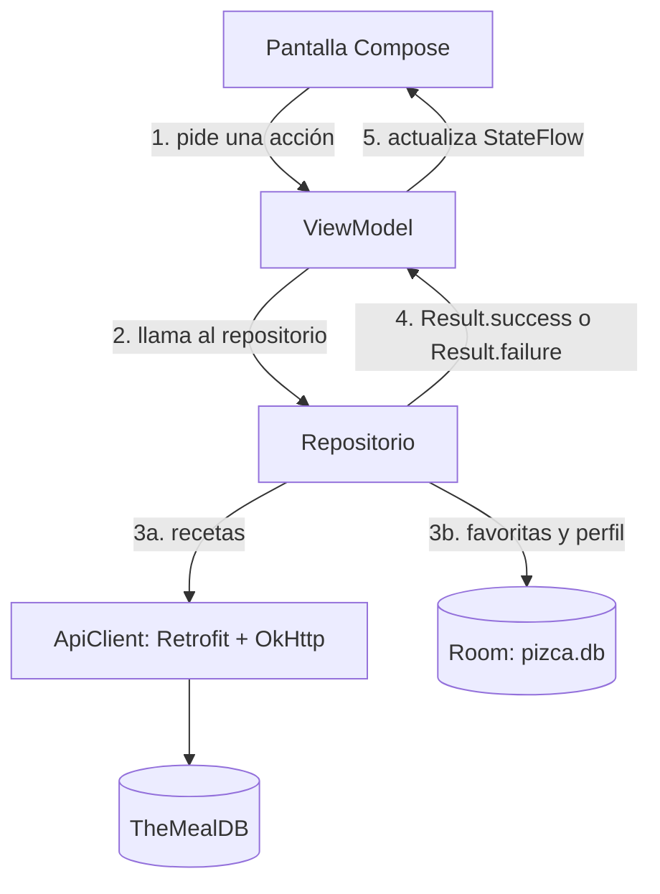

# Pizca — Tutorial de la capa de datos: red, repositorio y Room

Este tutorial explica, paso a paso, cómo Pizca obtiene sus datos en el **Avance 2**: las recetas llegan de **TheMealDB** con **Retrofit**, y las favoritas y el perfil se guardan en el celular con **Room**. Todo pasa por la **capa de repositorio**, siguiendo la arquitectura del Proyecto Integrador (*Referencia Avance 2*).

> La organización general de la app está en [tutorial_arquitectura.md](tutorial_arquitectura.md).

## 1. ¿Qué es la capa de repositorio?

El repositorio es el **intermediario** entre los ViewModels y las fuentes de datos (internet o la base de datos del celular). El ViewModel solo le pide datos; no sabe de dónde vienen ni cómo se consiguen.

| Ventaja | En Pizca |
|---|---|
| **Separación de responsabilidades** | Los ViewModels no saben nada de Retrofit ni de Room |
| **Fuente única de la verdad** | Si TheMealDB cambia, solo se modifica `RecetaRepositoryImpl` |
| **Facilidad para pruebas** | Como el repositorio es una `interface`, se puede reemplazar por uno de prueba (*fake*). Así trabajó el equipo mientras se construía la capa de red |

Cada repositorio tiene dos partes:

1. **La interface:** el contrato. Dice *qué* se puede pedir, como el menú de un restaurante.
2. **La implementación (`Impl`):** el código real. Dice *cómo* se consigue, como la cocina.

## 2. Flujo de la información



1. La pantalla le pide algo al ViewModel, por ejemplo cargar recetas.
2. El ViewModel llama al repositorio dentro de `viewModelScope.launch`.
3. El repositorio va a internet (TheMealDB) o a la base de datos del celular (Room).
4. El repositorio responde con un `Result`: éxito con los datos, o fallo con el error.
5. El ViewModel actualiza su `StateFlow` y Compose redibuja la pantalla.

## 3. Configuración

**Permiso de internet** en `app/src/main/AndroidManifest.xml`, antes de `<application>`:

```xml
<uses-permission android:name="android.permission.INTERNET" />
```

**Librerías** en `gradle/libs.versions.toml` y `app/build.gradle.kts`:

| Librería | Versión | Para qué |
|---|---|---|
| Retrofit + `converter-kotlinx-serialization` | 2.11.0 | Hacer peticiones HTTP y convertir el JSON |
| OkHttp `logging-interceptor` | 4.12.0 | Ver en Logcat cada petición y su respuesta |
| Kotlinx Serialization | 1.8.0 | Pasar de JSON a objetos Kotlin con `@Serializable` |
| Room (`runtime`, `ktx`, `compiler`) | 2.8.5 | Base de datos local |
| KSP | 2.3.10 | Lee las anotaciones de Room y genera su código |

```kotlin
// app/build.gradle.kts
implementation(libs.retrofit.core)
implementation(libs.retrofit.kotlinx.serialization)
implementation(libs.okhttp.logging)
implementation(libs.androidx.room.runtime)
implementation(libs.androidx.room.ktx)
ksp(libs.androidx.room.compiler)
```

## 4. DTOs: el molde del JSON

**Ubicación:** `data/dto/MealDbDtos.kt`

Un DTO (*Data Transfer Object*) tiene **exactamente** la forma del JSON que manda el servidor. Los nombres de las variables son iguales a los del JSON (`idMeal`, `strMeal`…), por eso no hace falta `@SerialName`.

```kotlin
// TheMealDB siempre responde { "meals": [ ... ] }.
// Si no encuentra nada responde { "meals": null }: por eso es nullable.
@Serializable
data class MealsResponse(
    val meals: List<MealDto>? = null
)

@Serializable
data class MealDto(
    val idMeal: String,
    val strMeal: String,
    val strCategory: String? = null,
    val strArea: String? = null,
    val strInstructions: String? = null,
    val strMealThumb: String? = null,
    val strIngredient1: String? = null, /* ... hasta strIngredient20 */
    val strMeasure1: String? = null     /* ... hasta strMeasure20 */
)
```

- **`@Serializable`:** permite que Kotlinx Serialization convierta el JSON en un objeto Kotlin automáticamente.
- **`meals` nullable:** cuando no hay resultados, TheMealDB no manda una lista vacía sino `null`. Con `.orEmpty()` lo convertimos en lista vacía y la app no se cierra.

En el mismo archivo están `CategoriasResponse` (para `categories.php`) y `AreasResponse` (para la lista de países).

## 5. La interface de la API

**Ubicación:** `data/api/TheMealDbApi.kt`

Retrofit convierte cada función de esta interface en una petición HTTP.

```kotlin
interface TheMealDbApi {

    @GET("search.php")
    suspend fun buscarPorNombre(@Query("s") nombre: String): MealsResponse

    @GET("lookup.php")
    suspend fun obtenerPorId(@Query("i") id: String): MealsResponse

    @GET("categories.php")
    suspend fun obtenerCategorias(): CategoriasResponse

    @GET("filter.php")
    suspend fun filtrarPorCategoria(@Query("c") categoria: String): MealsResponse

    @GET("filter.php")
    suspend fun filtrarPorIngrediente(@Query("i") ingrediente: String): MealsResponse

    @GET("filter.php")
    suspend fun filtrarPorPais(@Query("a") pais: String): MealsResponse

    @GET("list.php?a=list")
    suspend fun listarPaises(): AreasResponse
}
```

TheMealDB recibe los datos después del `?` de la URL. Por eso Pizca usa **`@Query`** y no `@Path`, como el ejemplo de AutoRent con MockAPI:

| Anotación | Arma la URL así | Ejemplo |
|---|---|---|
| `@Path("id")` | `cliente/7` | AutoRent (MockAPI) |
| `@Query("s")` | `search.php?s=pasta` | Pizca (TheMealDB) |

**Endpoints que usa Pizca:**

| Endpoint | Para qué |
|---|---|
| `search.php?s=` | Recetas de Inicio (vacío = varias) y búsqueda por nombre |
| `categories.php` | Chips de categorías en Inicio |
| `filter.php?c=` | Recetas de una categoría |
| `filter.php?i=` | Recetas con un ingrediente |
| `list.php?a=list` | Lista de países |
| `filter.php?a=` | Recetas de un país |
| `lookup.php?i=` | Receta completa (Detalle y Chef Teo) |

## 6. El cliente de red

**Ubicación:** `data/network/ApiClient.kt`

`ApiClient` es un `object` (una sola instancia en toda la app) que arma Retrofit.

```kotlin
object ApiClient {

    /** Siempre termina en "/". El 1 es la clave gratis de prueba. */
    private const val BASE_URL = "https://www.themealdb.com/api/json/v1/1/"

    private val json = Json {
        ignoreUnknownKeys = true   // TheMealDB manda campos que no usamos (strTags, strYoutube...)
        coerceInputValues = true   // si llega null donde hay valor por defecto, usa el valor por defecto
        isLenient = true           // acepta JSON un poco desordenado
    }

    /** Imprime en Logcat cada petición y su respuesta */
    private val loggingInterceptor = HttpLoggingInterceptor().apply {
        level = HttpLoggingInterceptor.Level.BODY
    }

    private val okHttpClient = OkHttpClient.Builder()
        .addInterceptor(loggingInterceptor)
        .build()

    private val retrofit: Retrofit by lazy {
        Retrofit.Builder()
            .baseUrl(BASE_URL)
            .client(okHttpClient)
            .addConverterFactory(json.asConverterFactory("application/json".toMediaType()))
            .build()
    }

    val mealDbApi: TheMealDbApi by lazy {
        retrofit.create(TheMealDbApi::class.java)
    }
}
```

| Pieza | Es como… | Qué hace |
|---|---|---|
| `TheMealDbApi` | El menú | Dice qué se puede pedir |
| **Retrofit** | Quien toma el pedido | Arma la petición a partir de `@GET` y `@Query` |
| **OkHttp** | El domiciliario | Viaja a internet y trae la respuesta |
| **Kotlinx Serialization** | Quien desempaca | Convierte el JSON en `MealDto` |
| **Logging Interceptor** | La cámara del domiciliario | Muestra cada viaje en Logcat |

## 7. El mapper: de TheMealDB a Pizca

**Ubicación:** `data/mapper/MealMapper.kt`

TheMealDB manda los ingredientes en 20 campos sueltos (`strIngredient1`… `strIngredient20`) y las instrucciones en un solo texto. El mapper los convierte en la `Receta` que usa la app:

```kotlin
fun MealDto.toReceta(categoriaPorDefecto: String = ""): Receta {
    // 1. Los 20 pares (ingrediente, medida)
    val pares = listOf(strIngredient1 to strMeasure1, /* ... */ strIngredient20 to strMeasure20)

    // 2. Nos quedamos solo con los que tienen nombre
    val ingredientes = pares.mapNotNull { (nombre, medida) ->
        if (nombre.isNullOrBlank()) null
        else Ingrediente(nombre = nombre.trim(), medida = medida?.trim().orEmpty())
    }

    // 3. Las instrucciones se parten por saltos de línea
    val pasos = strInstructions.orEmpty()
        .split(Regex("\\r?\\n"))
        .map { it.trim() }
        .filter { it.isNotBlank() && !it.matches(Regex("(?i)step\\s*\\d+")) }

    return Receta(
        id = idMeal,
        nombre = strMeal,
        categoria = strCategory ?: categoriaPorDefecto,
        pais = strArea.orEmpty(),
        imagenUrl = strMealThumb.orEmpty(),
        ingredientes = ingredientes,
        pasos = pasos
    )
}
```

Así, ninguna pantalla tiene que saber cómo es el JSON de TheMealDB.

## 8. El repositorio de recetas

**Ubicación:** `data/repository/`

### 8.1 La interface (el contrato)

```kotlin
interface RecetaRepository {
    suspend fun obtenerRecetas(): Result<List<Receta>>
    suspend fun obtenerCategorias(): Result<List<String>>
    suspend fun obtenerPorCategoria(categoria: String): Result<List<Receta>>
    suspend fun buscarPorNombre(nombre: String): Result<List<Receta>>
    suspend fun buscarPorIngredientes(ingredientes: List<String>): Result<List<Receta>>
    suspend fun obtenerPaises(): Result<List<String>>
    suspend fun buscarPorPais(pais: String): Result<List<Receta>>
    suspend fun obtenerPorId(id: String): Result<Receta>
}
```

### 8.2 La implementación

```kotlin
class RecetaRepositoryImpl(
    private val api: TheMealDbApi = ApiClient.mealDbApi
) : RecetaRepository {

    override suspend fun buscarPorNombre(nombre: String): Result<List<Receta>> = runCatching {
        api.buscarPorNombre(nombre.trim()).meals.orEmpty().map { it.toReceta() }
    }

    override suspend fun obtenerPorId(id: String): Result<Receta> = runCatching {
        api.obtenerPorId(id).meals?.firstOrNull()?.toReceta()
            ?: error("No encontramos la receta $id")   // error() lanza una excepción → Result.failure
    }

    // ... el resto de funciones sigue el mismo patrón
}
```

### 8.3 Conceptos clave

| Concepto | Qué hace |
|---|---|
| **`suspend fun`** | La función puede tardar (va a internet) sin congelar la pantalla |
| **`Result<T>`** | Envuelve la respuesta: `Result.success(datos)` si salió bien, `Result.failure(error)` si falló |
| **`runCatching { }`** | Reemplaza el `try / catch`: ejecuta el bloque y, si algo falla (sin internet, error 404, JSON inválido), devuelve `Result.failure` en vez de cerrar la app |
| **API por el constructor** | `api: TheMealDbApi = ApiClient.mealDbApi` usa la API real por defecto, pero permite pasar otra en una prueba |

### 8.4 Búsqueda por varios ingredientes

En la versión gratuita de TheMealDB, `filter.php?i=` acepta **un solo ingrediente**. Para buscar con varios, el repositorio pide uno por uno y se queda con las recetas que aparecen en **todas** las respuestas:

```kotlin
override suspend fun buscarPorIngredientes(ingredientes: List<String>): Result<List<Receta>> = runCatching {
    if (ingredientes.isEmpty()) return@runCatching emptyList<Receta>()
    val listas = ingredientes.map { ingrediente ->
        val formato = ingrediente.trim().lowercase().replace(" ", "_")   // "chicken breast" → "chicken_breast"
        api.filtrarPorIngrediente(formato).meals.orEmpty().map { it.toReceta() }
    }
    val idsEnTodas = listas
        .map { lista -> lista.map { it.id }.toSet() }
        .reduce { a, b -> a intersect b }
    listas.first().filter { it.id in idsEnTodas }
}
```

## 9. Persistencia local con Room

TheMealDB es una API pública de **solo lectura**. Para guardar, actualizar y eliminar datos, Pizca usa **Room**, la base de datos local de Android. Room es como un **cuaderno dentro del celular**:

| Pieza | Es como… | Archivos en `data/local/` |
|---|---|---|
| **Entity** | Una tabla con columnas | `RecetaFavoritaEntity`, `PerfilEntity` |
| **DAO** | Quien busca y anota en la tabla | `FavoritaDao`, `PerfilDao` |
| **Database** | El cuaderno con todas las tablas | `PizcaDatabase` |
| **PizcaApp** | Quien abre el cuaderno una vez al iniciar la app | `PizcaApp.kt` |

### 9.1 Entidad (la tabla)

```kotlin
@Entity(tableName = "recetas_favoritas")
data class RecetaFavoritaEntity(
    @PrimaryKey val id: String,          // el id de TheMealDB, nunca se repite
    val nombre: String,
    val categoria: String,
    val pais: String,
    val imagenUrl: String
)
```

`PerfilEntity` es la tabla `perfil`. Como hay un solo usuario, siempre se usa la fila `id = 1`.

### 9.2 DAO (las consultas)

```kotlin
@Dao
interface FavoritaDao {

    // Flow = "avísame cada vez que la tabla cambie"
    @Query("SELECT * FROM recetas_favoritas ORDER BY nombre")
    fun observarTodas(): Flow<List<RecetaFavoritaEntity>>

    @Query("SELECT EXISTS(SELECT 1 FROM recetas_favoritas WHERE id = :id)")
    fun observarSiExiste(id: String): Flow<Boolean>

    @Insert(onConflict = OnConflictStrategy.REPLACE)
    suspend fun insertar(receta: RecetaFavoritaEntity)

    @Query("DELETE FROM recetas_favoritas WHERE id = :id")
    suspend fun eliminar(id: String)
}
```

`PerfilDao` usa `@Upsert`: inserta el perfil si no existe y lo actualiza si ya existe.

### 9.3 La base de datos y `PizcaApp`

```kotlin
@Database(
    entities = [RecetaFavoritaEntity::class, PerfilEntity::class],
    version = 1,
    exportSchema = false
)
abstract class PizcaDatabase : RoomDatabase() {
    abstract fun favoritaDao(): FavoritaDao
    abstract fun perfilDao(): PerfilDao
}
```

```kotlin
// Se ejecuta UNA vez cuando arranca la app, antes que cualquier pantalla
class PizcaApp : Application() {
    companion object {
        lateinit var database: PizcaDatabase
            private set
    }
    override fun onCreate() {
        super.onCreate()
        database = Room.databaseBuilder(this, PizcaDatabase::class.java, "pizca.db").build()
    }
}
```

`PizcaApp` se registra en el `AndroidManifest.xml` con `android:name=".PizcaApp"`.

### 9.4 Repositorio de favoritas

Mismo patrón que el de recetas: interface + Impl, y el DAO entra por el constructor.

```kotlin
class FavoritaRepositoryImpl(
    private val dao: FavoritaDao = PizcaApp.database.favoritaDao()
) : FavoritaRepository {

    override fun observarFavoritas(): Flow<List<Receta>> =
        dao.observarTodas().map { lista -> lista.map { it.toReceta() } }

    override fun esFavorita(id: String): Flow<Boolean> =
        dao.observarSiExiste(id)

    override suspend fun alternarFavorita(receta: Receta): Result<Unit> = runCatching {
        if (dao.existe(receta.id)) dao.eliminar(receta.id)
        else dao.insertar(receta.toFavoritaEntity())
    }
}
```

**¿Por qué `Flow` en Room y `Result` en la API?** A la API se le pregunta una vez y responde una vez (`suspend` + `Result`). Con Room, en cambio, la app se **suscribe** con `Flow` y recibe un aviso cada vez que la tabla cambia. Por eso el corazón y la lista "Mis favoritas" se actualizan solos.

### 9.5 Guardar, consultar, actualizar y eliminar

| Operación | Dónde se ve en la app | Cómo se hace |
|---|---|---|
| **Guardar** | Tocar ❤️ en el Detalle | `FavoritaDao.insertar` |
| **Consultar** | Perfil → "Mis favoritas" y el corazón lleno | `observarTodas` / `observarSiExiste` con `Flow` |
| **Actualizar** | "Calcular mi meta diaria" en Perfil | `PerfilDao.guardar` con `@Upsert` |
| **Eliminar** | Tocar ❤️ otra vez | `FavoritaDao.eliminar` |

## 10. Cómo se consume el repositorio desde el ViewModel

Ejemplo real de `InicioViewModel`:

```kotlin
class InicioViewModel(
    private val repository: RecetaRepository = RecetaRepositoryImpl()
) : ViewModel() {

    private val _recetas = MutableStateFlow<List<Receta>>(emptyList())
    val recetas: StateFlow<List<Receta>> = _recetas.asStateFlow()

    private val _isLoading = MutableStateFlow(false)
    val isLoading: StateFlow<Boolean> = _isLoading.asStateFlow()

    private val _errorMessage = MutableStateFlow<String?>(null)
    val errorMessage: StateFlow<String?> = _errorMessage.asStateFlow()

    fun cargarRecetas() {
        viewModelScope.launch {
            _isLoading.value = true
            _errorMessage.value = null
            repository.obtenerRecetas()
                .onSuccess { lista -> _recetas.value = lista }
                .onFailure { _errorMessage.value = "No pudimos cargar las recetas. Revisa tu internet." }
            _isLoading.value = false
        }
    }
}
```

La pantalla lee `isLoading` y `errorMessage` con `collectAsState()`: muestra `Cargando` mientras espera, `ErrorCard` con **Reintentar** si falló, o la lista de recetas si todo salió bien.

## 11. Cómo probarlo

### 11.1 Prueba unitaria de la capa de red

**Ubicación:** `app/src/test/java/com/adso/pizca/RecetaRepositoryTest.kt`

Cuatro pruebas que llaman de verdad a TheMealDB (el computador necesita internet):

| Prueba | Qué comprueba |
|---|---|
| `buscarPorNombre_traeRecetas` | Buscar "Arrabiata" devuelve recetas |
| `obtenerPorId_traeIngredientesYPasos` | La receta `52772` llega con ingredientes y pasos (el mapper funciona) |
| `sinResultados_devuelveListaVacia` | Si no hay resultados (`meals: null`), el resultado es una lista vacía y no un error |
| `buscarPorDosIngredientes_funciona` | La búsqueda con "chicken" y "garlic" responde bien |

Para correrla: flecha verde ▶ al lado de `class RecetaRepositoryTest` → **Run**. Resultado: ✅ **4 tests passed**.

### 11.2 Logcat

Con la app corriendo, escribe `okhttp` en el filtro de **Logcat**. `-->` es la petición que sale del celular y `<--` la respuesta del servidor:

```text
--> GET https://www.themealdb.com/api/json/v1/1/search.php?s=
<-- 200 OK
{"meals":[{"idMeal":"52771","strMeal":"Spicy Arrabiata Penne", ...
```

### 11.3 Database Inspector

**View → Tool Windows → App Inspection → Database Inspector** muestra `pizca.db` con las tablas `recetas_favoritas` y `perfil`. Al tocar ❤️ en una receta, aparece una fila nueva.

### 11.4 Sin internet

Con el Wi-Fi del emulador apagado, cada pantalla muestra una tarjeta de error con **Reintentar** y la app no se cierra, gracias a `runCatching` y `Result`.

## 12. Lista de verificación

- [x] Permiso INTERNET en el `AndroidManifest.xml`
- [x] Retrofit, Kotlinx Serialization, OkHttp y Room configurados en Gradle
- [x] DTOs con `@Serializable`
- [x] La URL base termina en `/`
- [x] Las funciones de la API son `suspend`
- [x] Cada repositorio tiene interface e implementación
- [x] Las funciones del repositorio devuelven `Result<T>` con `runCatching`
- [x] La API y los DAOs entran por el constructor
- [x] Los ViewModels usan `viewModelScope.launch` con `onSuccess` / `onFailure`
- [x] Cada pantalla muestra cargando y error
- [x] Favoritas y perfil siguen guardados después de cerrar la app
