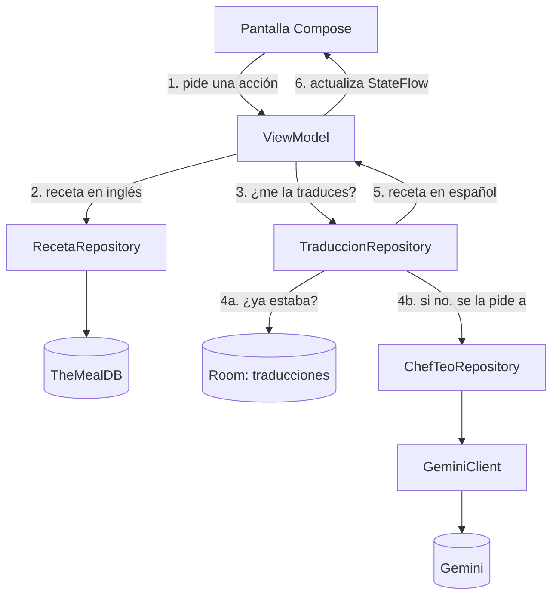

# Pizca — Tutorial de la integración con Gemini

Este tutorial explica, paso a paso, cómo Pizca usa **Gemini** en el **Avance 3**: Chef Teo conversa con IA y toda la app se ve en español, aunque TheMealDB solo trae datos en inglés. Se respeta la misma arquitectura por capas del Avance 2.

> La capa de datos (Retrofit, repositorios y Room) está explicada en [tutorial_capa_datos.md](tutorial_capa_datos.md).

## 1. ¿Qué es Firebase AI Logic y por qué lo usamos?

**Gemini** es la IA de Google: es la que traduce y conversa. **Firebase AI Logic** es el camino para llegar a Gemini desde la app.

| Pieza | Analogía | Qué hace |
|---|---|---|
| **Gemini** | El chef | Traduce y responde |
| **Firebase AI Logic** | El mesero | Lleva el mensaje de la app a Gemini y trae la respuesta |
| **App Check** | El portero | Revisa que quien pide sea de verdad nuestra app |

¿Por qué no llamar a Gemini directo con Retrofit? Porque habría que guardar la **API key** dentro de la app, y cualquiera podría sacarla del APK. Con Firebase AI Logic **no hay API key en el código**.

## 2. Flujo de la información



1. La pantalla le pide algo al ViewModel, por ejemplo abrir una receta.
2. El ViewModel trae la receta de TheMealDB (en inglés) y la muestra de una vez.
3. Le pide al `TraduccionRepository` la versión en español.
4. El repositorio mira primero en Room. Si no está, se la pide a Gemini y la guarda.
5. Devuelve la receta traducida.
6. El ViewModel actualiza su `StateFlow` y Compose redibuja la pantalla en español.

## 3. Configuración

### 3.1 Firebase

1. En [console.firebase.google.com](https://console.firebase.google.com) se creó el proyecto **Pizca** y se agregó la app Android `com.adso.pizca`.
2. El archivo `google-services.json` va en la carpeta `app/`.
3. En **AI Services → AI Logic** se activó la **Gemini Developer API** (plan gratis, sin tarjeta). El asistente activa **App Check**.

### 3.2 Librerías

| Librería | Versión | Para qué |
|---|---|---|
| Firebase BoM | 35.1.0 | Un "combo": elige las versiones correctas de todas las librerías de Firebase |
| `firebase-ai` | (BoM) | Firebase AI Logic |
| `firebase-appcheck-debug` | (BoM) | App Check en modo depuración |
| Plugin `com.google.gms.google-services` | 4.5.0 | Lee el `google-services.json` |

```kotlin
// app/build.gradle.kts
plugins {
    alias(libs.plugins.google.services)
}

dependencies {
    implementation(platform(libs.firebase.bom))
    implementation(libs.firebase.ai)
    implementation(libs.firebase.appcheck.debug)
}
```

### 3.3 App Check al arrancar la app

```kotlin
// PizcaApp.kt, dentro de onCreate()
Firebase.initialize(context = this)
Firebase.appCheck.installAppCheckProviderFactory(
    DebugAppCheckProviderFactory.getInstance()
)
```

En modo depuración, cada emulador o celular tiene su propio **token**. La primera vez que corre la app, el token aparece en **Logcat** (buscar `secret`). Hay que registrarlo en **App Check → Apps → ⋮ → Administrar tokens de depuración**. Sin ese paso, Gemini rechaza las llamadas.

> En celulares HONOR y Huawei el mensaje del token no aparece en Logcat, porque esconden los mensajes de depuración. Es mejor sacarlo desde un emulador.

## 4. El cliente de Gemini

`GeminiClient` es el "gemelo" de `ApiClient`: así como `ApiClient` arma Retrofit para TheMealDB, `GeminiClient` arma los modelos de Gemini. Es un `object` porque solo debe existir uno en toda la app.

| Modelo | Para qué | Configuración |
|---|---|---|
| `chat` | Conversar | `gemini-3.5-flash`, con la personalidad de Teo (`systemInstruction`) |
| `traductor` | Traducir una receta completa | `gemini-3.5-flash`, responde solo JSON |
| `ligero` | Traducciones cortas: nombres y búsquedas | `gemini-3.5-flash-lite`, más rápido, responde solo JSON |

```kotlin
private val personalidad = content {
    text("Eres Chef Teo, un ratón chef simpático de la app Pizca. ...")
}

// Gemini "piensa" antes de responder. Con LOW piensa menos y responde más rápido.
private val pensarPoco = thinkingConfig { thinkingLevel = ThinkingLevel.LOW }

val chat by lazy {
    Firebase.ai(backend = GenerativeBackend.googleAI())
        .generativeModel(
            modelName = MODELO,
            generationConfig = generationConfig { thinkingConfig = pensarPoco },
            systemInstruction = personalidad
        )
}
```

- `systemInstruction`: lo que Gemini lee antes de cada respuesta. Así siempre habla como Teo.
- `responseMimeType = "application/json"`: obliga a Gemini a responder en JSON, para poder convertir la respuesta en objetos Kotlin, igual que con TheMealDB.
- `by lazy`: el modelo se crea la primera vez que se usa, no al abrir la app.

## 5. El repositorio de Chef Teo

### 5.1 La interface (el contrato)

```kotlin
interface ChefTeoRepository {
    suspend fun traducir(receta: Receta): Result<Receta>
    suspend fun responder(receta: Receta, pasoActual: Int, historial: List<Mensaje>, pregunta: String): Result<String>
    fun responderEnVivo(receta: Receta, pasoActual: Int, historial: List<Mensaje>, pregunta: String): Flow<String>
}
```

La interface no dice que se usa Gemini. Si mañana se cambia de IA, solo se cambia la implementación.

### 5.2 Traducir una receta

1. Se arma un **prompt** con el nombre, los pasos numerados y los ingredientes.
2. Se le pide a Gemini que responda con esta forma: `{"nombre": "...", "pasos": [...], "ingredientes": [{"nombre": "...", "medida": "..."}]}`.
3. El JSON se convierte en `TraduccionDto` con Kotlinx Serialization.
4. **Validación:** si Gemini devolvió un número distinto de pasos o ingredientes, la traducción no se usa (`error(...)`).
5. Todo va dentro de `runCatching`: un error de Gemini se vuelve `Result.failure` y la app no se cae.

### 5.3 Conversar "en vivo"

```kotlin
override fun responderEnVivo(...): Flow<String> = flow {
    var acumulado = ""
    chat.generateContentStream(armarPrompt(...)).collect { pedacito ->
        acumulado += pedacito.text.orEmpty()
        if (acumulado.isNotBlank()) emit(acumulado.trim())
    }
}
```

`generateContentStream` entrega la respuesta **por pedacitos**, a medida que Gemini la escribe. Cada vez que llega uno, se emite el texto completo hasta ese momento, y el ViewModel actualiza la burbuja de Teo. Así la respuesta se ve aparecer palabra por palabra.

Para que sea más rápido, el prompt solo lleva el nombre de la receta, los ingredientes, el **paso actual** y los últimos 6 mensajes, no la receta completa.

## 6. El repositorio de traducciones (con caché en Room)

### 6.1 La tabla `traducciones`

```kotlin
@Entity(tableName = "traducciones")
data class TraduccionEntity(
    @PrimaryKey val clave: String,   // "receta:52772", "nombre:52772", "ingles:pollo"
    val valor: String                // la traducción (texto o JSON)
)
```

Al agregar una tabla, la base de datos pasa de la **versión 1 a la 2**. Para no borrar las favoritas ni el perfil que ya estaban guardados, se escribió una **migración** que solo crea la tabla nueva:

```kotlin
val MIGRACION_1_2 = object : Migration(1, 2) {
    override fun migrate(db: SupportSQLiteDatabase) {
        db.execSQL("CREATE TABLE IF NOT EXISTS `traducciones` (`clave` TEXT NOT NULL, `valor` TEXT NOT NULL, PRIMARY KEY(`clave`))")
    }
}
```

### 6.2 Qué traduce

| Función | Se usa en | Cómo |
|---|---|---|
| `receta(receta)` | Detalle y Chef Teo | Room → si no está, `ChefTeoRepository.traducir()` → se guarda |
| `nombres(recetas)` | Inicio y Búsqueda | Room → los que faltan se traducen **todos en una sola llamada** a Gemini |
| `aIngles(texto)` | Búsqueda | "pollo" → "chicken", porque TheMealDB solo entiende inglés |

Como Detalle y Chef Teo comparten la misma traducción guardada, si abres una receta en Detalle y luego tocas "Cocinar con Chef Teo", la receta ya sale en español al instante.

### 6.3 Categorías y países: sin Gemini

Las categorías (*Beef, Dessert…*) y los países (*Italian, Mexican…*) son pocos y casi nunca cambian. Por eso se traducen con una tabla fija en `Diccionario.kt`, que es instantánea y gratis. La app sigue guardando el valor en inglés, porque TheMealDB lo necesita así para filtrar: el Diccionario solo se usa para **mostrarlo**.

## 7. Cómo se consume desde el ViewModel

```kotlin
// DetalleViewModel
val resultado = recetaRepository.obtenerPorId(id)
resultado.onSuccess { _receta.value = it }          // 1. se ve de una vez (en inglés)
_isLoading.value = false

resultado.getOrNull()?.let { original ->
    traduccion.receta(original).onSuccess { traducida ->
        if (_receta.value?.id == traducida.id) _receta.value = traducida   // 2. cambia a español
    }
}
```

- La pantalla no se queda esperando a Gemini: primero muestra la receta y luego la cambia por la traducida.
- El `if` evita mostrar una traducción vieja si el usuario ya abrió otra receta.

En Chef Teo, mientras Gemini responde, `escribiendo = true` muestra la burbuja **"Teo está escribiendo…"**. Con la primera palabra que llega, la burbuja se reemplaza por la respuesta, que sigue creciendo.

Los comandos cortos ("siguiente", "ingredientes") se resuelven en el ViewModel **sin llamar a Gemini**: son instantáneos y no gastan cuota.

## 8. Cómo probarlo

1. **Inicio:** categorías en español y nombres que cambian a español. La segunda vez salen de una vez.
2. **Detalle:** nombre, ingredientes y pasos en español.
3. **Chef Teo:** pregunta algo libre y mira cómo la respuesta aparece palabra por palabra.
4. **Búsqueda:** escribe "pollo".
5. **Modo avión:** Teo avisa que no pudo traducir y la app no se cierra.
6. **Logcat:** si algo falla, filtra `tag:ChefTeo` o `tag:Traduccion` para ver el motivo.
7. **Database Inspector:** en la tabla `traducciones` se ven las traducciones guardadas.

## 9. Lista de verificación

- [ ] `google-services.json` en `app/`
- [ ] AI Logic activo en Firebase con Gemini Developer API
- [ ] Token de depuración del emulador registrado en App Check
- [ ] Sin API key de Gemini en el código
- [ ] Chef Teo traduce la receta y responde preguntas libres
- [ ] Inicio, Detalle y Búsqueda en español
- [ ] La app no se cae sin internet
